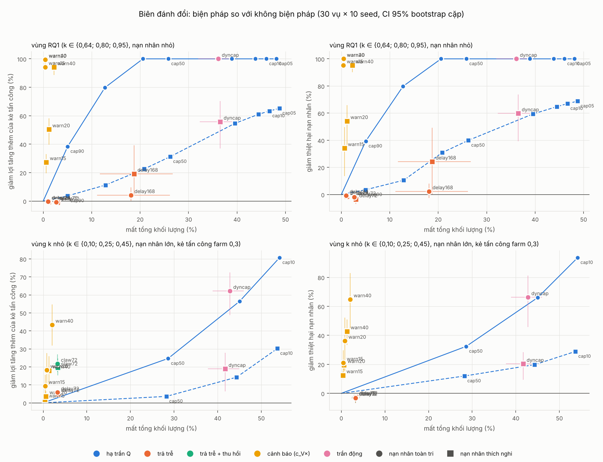
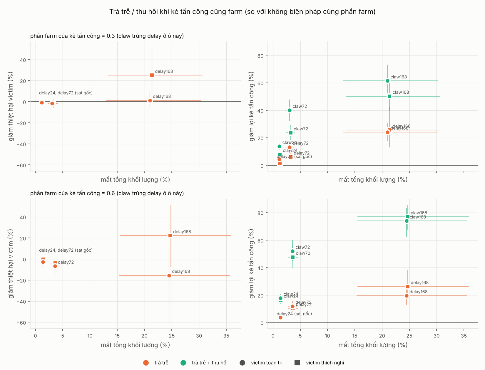
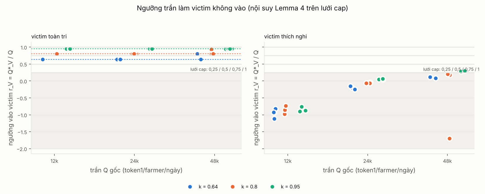
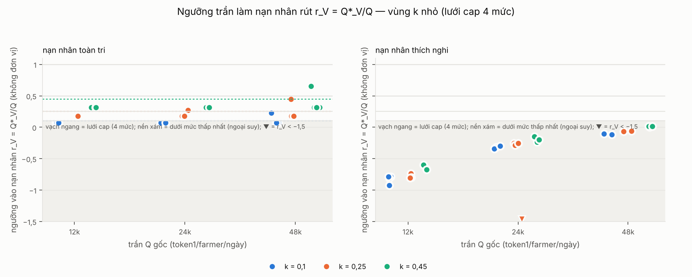
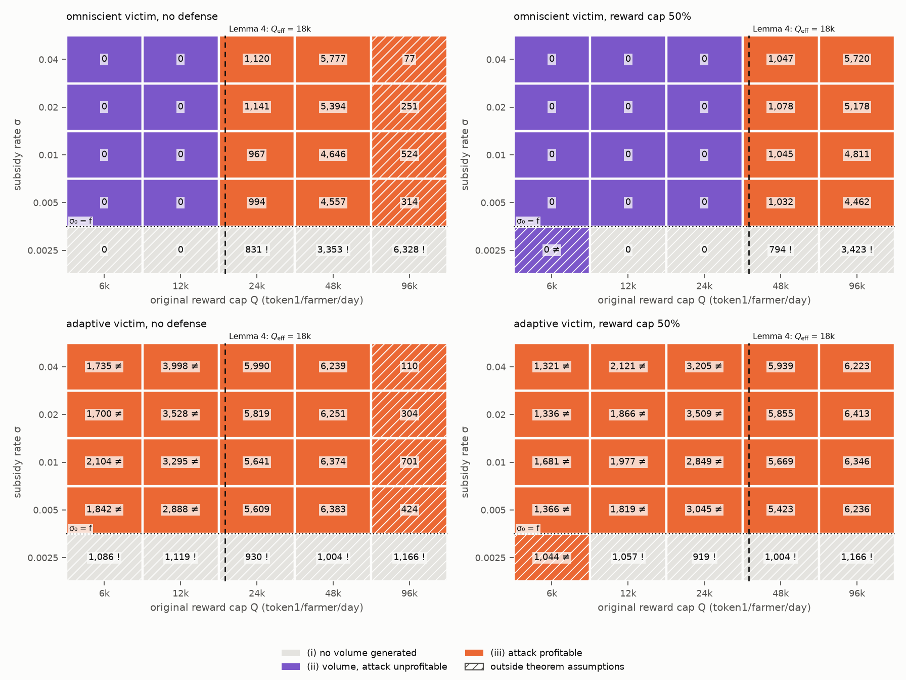
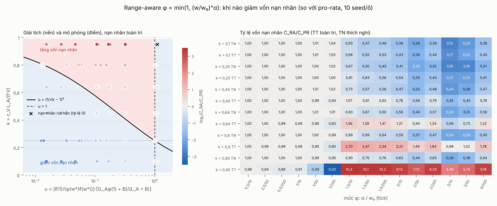
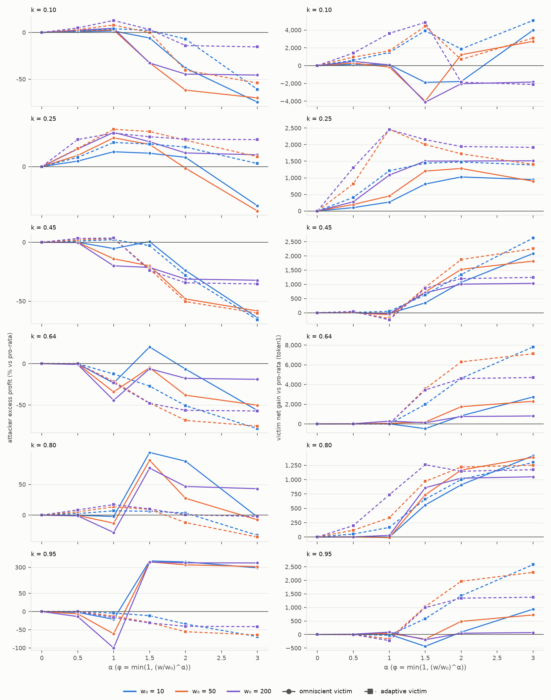
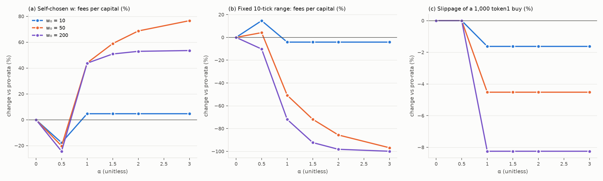
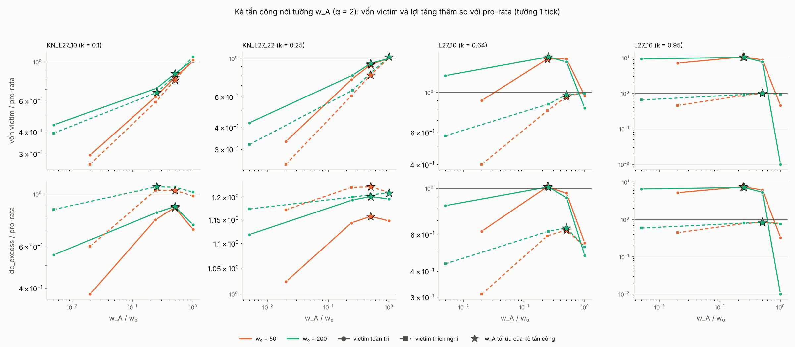
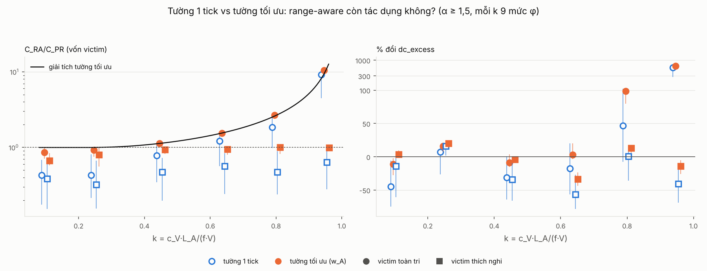

# Bản thảo phần kết quả (mục 5–10)

> Bản ghép của vai B, 15/10/2026, từ các bản nháp `muc5_…`, `muc6_…`, `muc7_…`, `muc8_…` (giữ lại làm lưu trữ). Mọi con số được kiểm lại bằng pandas trên `ket_qua/rq1/*.csv`, `ket_qua/gd2/bang/`, `ket_qua/gd3/bang/` ngày 15/10. Mô hình và thiết kế thí nghiệm ở Mục 4 (`muc4_mo_hinh.md`, vai C); nền tảng CLMM ở `nen_tang_CLMM.md` (vai A). Quy ước: tiền tính bằng token1 (đồng định giá), thời gian tính bằng bước 1 giờ, số viết theo kiểu Việt (phẩy thập phân). "CI" là khoảng tin cậy 95%.
>
> Sinh lại số liệu: `python -m metrics.chay_rq1` (≈ 60 s), `python -m metrics.chay_gd2` (≈ 2 phút), `python -m metrics.chay_gd3` (≈ 15 s). Sinh lại hình: `python -m plots.ve_rq1`, `python -m plots.ve_gd2`, `python -m plots.ve_gd3` (mỗi lệnh < 15 s).

---

## 5. Phương pháp đo lường

Mọi chỉ số được tính **chỉ từ log sự kiện** của simulator (mint, burn, collect, swap, subsidy, step; `INTERFACE.md` mục 4) và meta của lượt chạy. Ngoại lệ duy nhất là phản thực "bán thẳng" (5.2): nó dựng lại bể từ log rồi hỏi giá bằng chính engine. Cách đo bám theo §5–§6 của bài gốc, kể cả khi có lựa chọn khác hợp lý hơn; những biến thể chúng tôi thêm vào được ghi là chỉ số phụ. Code: `metrics/` (`phases.py`, `indicators.py`, `pnl.py`, `report.py`, `validate.py`).

### 5.1 Mốc thời gian và pha

Tường là khoảng một tick có tổng thanh khoản (cộng mọi địa chỉ) đạt đỉnh lớn nhất. Các mốc được tìm bằng cách phát lại mint/burn trên khoảng đó; chúng tôi **không** dùng nhãn vai trò của simulator, để bộ đo làm việc giống như trên dữ liệu chuỗi thật.

**Bảng 5.1.** Các mốc thời gian (theo §5–§6.1 bài gốc).

| Mốc | Định nghĩa |
|---|---|
| `t_m` | mint đầu tiên vào tick tường |
| `t_50` | lần đầu thanh khoản tick tường ≥ 50% đỉnh |
| `t_peak` | lần đầu chạm đỉnh |
| `t_0` | lần đầu sau đỉnh thanh khoản tụt dưới 95% đỉnh (§6.1.1); đối chiếu thêm burn lớn nhất trên tick tường (§5) |
| `t_oot` | swap đầu tiên từ `t_0` đưa giá ra khỏi tick tường |
| `t_b` | giờ đầu tiên từ `t_0` có giá ≤ 90% giá biên dưới tick tường |

Bốn pha với `W = 24` giờ: Before `[t_m − W, t_m)`, Prep `[t_m, t_0)`, Attack `[t_0, t_b]`, Post `(t_b, t_b + W]`. Lượt không sập đủ 10% không có Attack và Post, và bị loại khỏi các chỉ số sau `t_0`.

### 5.2 Bốn chỉ số chính

**Suy vai trò.** Như bài gốc, vai được suy từ hành vi: *nạn nhân* còn thanh khoản trên tick tường tại `t_end`; *wall provider* vừa mint vừa burn trên tick tường trong `[t_m, t_end]`; *pressure trader* có swap bán alpha lấy token1 trong `[t_0, t_end]`; *kẻ tấn công* thỏa cả hai vai sau. Mặc định `t_end = t_b` (bài gốc thử cả `t_oot`).

**Bảng 5.2.** Bốn chỉ số theo đề bài và cách đo.

| Chỉ số | Định nghĩa | Ghi chú |
|---|---|---|
| Thiệt hại nạn nhân | `E_full = (y_dep + p̂·x_dep) − (y_back + p̂·x_back)`, thiệt hại = `max{0, E}`. `x, y` = alpha và token1 nạp vào, nhận lại (burn tới `t_end` cộng phần còn kẹt, định giá ở giá cuối `t_end`); `p̂` = trung bình VWAP giờ `t_b` và `t_b + 1` | Phí LP tách riêng, không trừ (bài gốc chỉ đo phần do cú sập). Bản bài gốc `E_nonalpha = y_dep − y_back − p̂·x_back` trừ toàn bộ alpha nhận lại, kể cả alpha tự nạp, nên luôn ≤ bản đầy đủ; hai bản chênh đúng `p̂·x_dep` |
| Lợi nhuận kẻ tấn công | **Paper** (bài gốc): token1 thu từ swap chiều sập trong `[t_0, t_end]`. **Tăng thêm** (`excess`, theo Theorem 6): paper trừ giá trị khi bán thẳng cùng lượng alpha vào một bể phản thực đã bỏ tường và nạn nhân (dựng lại từ log ngay trước burn tường đầu tiên, phát lại các sự kiện khác, farmer tối ưu lại; Mục 4.5). **Đầy đủ**: dòng token1 ròng của phần tấn công trong `[t_m, t_end]` cộng thay đổi kho × `c_A` cộng lãi săn trợ cấp | Paper gồm cả tiền xả vào thanh khoản nền nên dương cả khi không có nạn nhân; `excess` = 0 đúng khi không có nạn nhân (có test). Khi kẻ tấn công cũng săn trợ cấp, lệnh mua của nó tách thành **lãi farm** = thưởng nhận − Σ(v − P_e·x), không vào paper hay excess. GĐ2–GĐ3 đo theo địa chỉ thật `attacker:0` (`dc_*`), nên có cả ở lượt không sập |
| Chi phí trợ cấp | Tổng các dòng `subsidy` **cộng khoản trả trễ đã chốt chưa tới hạn** khi hết kịch bản; khoản bị thu hồi báo riêng; tách phần trả cho kẻ tấn công | Không cộng khoản treo thì biện pháp trả trễ trông rẻ giả tạo |
| Thanh khoản bể | `L_active` theo giờ, trung bình Before so với Post; độ tụt tick tường tại `t_b`: `drop = (L_max − L(t_b))/L_max` (§6.2.4) | `L(t)` cộng mọi địa chỉ trên tick tường, nên phần nạn nhân còn kẹt làm `drop` < 100% |

**Chỉ số thị trường theo pha (§6.2).** *Volume lift* `Lift_s = μ_s / μ_Before`, với `μ` là khối lượng token1 trung bình mỗi giờ. Chỉ số chính tính trên mọi swap, gồm cả arbitrageur (bài gốc đếm mọi dòng non-alpha trên chuỗi); chỉ số phụ bỏ arbitrageur. *Biến động thực hiện* `RV = √Σ r_i²`, với `r_i = ln(1,0001)·(tick_i − tick_{i−1})` qua các swap liên tiếp trong pha. *Độ dời giá* theo VWAP giờ: `before = (P(t_m) − P(t_m − 1))/P(t_m)`, `attack = (P̄(t_b) − P(t_0))/P(t_0)`. Biến thể phụ của `attack` lấy mốc là giá bể ngay trước burn tường đầu tiên, vì VWAP giờ `t_0` đã gồm cú xả nên ước thấp độ sập.

### 5.3 Hai chỉ số dẫn xuất

*Hiệu quả chi tiêu* `eff_gain = (L̄_Post − L̄_Before)/S`, với `S` là tổng trợ cấp (đơn vị L trên mỗi token1); `eff_gain ≤ 0` nghĩa là trợ cấp không mua thêm được thanh khoản nào. *Tỷ lệ rò rỉ* = lợi nhuận kẻ tấn công / `S`, tính cho cả ba bản lợi nhuận. Đây là họ hàng của chỉ số "cải thiện trên mỗi đô-la khuyến khích" trong StableSims (Kirillov 2022).

### 5.4 Kiểm định hai lớp

Theo Tarantelli (2026), mục tiêu là tái lập **dấu hiệu** chứ không tái lập quỹ đạo.

- **Lớp cơ học** (test của vai A và C): bảo toàn token, phí ≥ 0, swap xuyên tick khớp một bể tham chiếu độc lập (sai < 10⁻⁸), nạn nhân toàn tri đạt `L_V*/L_A = 1` tại `L_A = fQ/(4c_V)`.
- **Lớp dấu hiệu** (`validate_rq1`): kiểm theo **phân phối qua các lượt**. Mỗi tiêu chí là tỷ lệ lượt mô phỏng thỏa một phát biểu của bài gốc, đặt cạnh tỷ lệ tương ứng của bài gốc (x/29). Tiêu chí đạt khi tỷ lệ mô phỏng ≥ 50% (mọi phát biểu của bài gốc đều đúng với đa số vụ); riêng "có vụ lift Attack > 5×" chỉ cần ít nhất một lượt. Lift Prep không có ngưỡng; phân phối của nó được so trực tiếp với Bảng 4 bài gốc. Kèm theo là ba bảng chia nhóm như Bảng 4, 6, 7 của bài gốc.

### 5.5 Số lần lặp và khoảng tin cậy

Thiết kế bộ tổ hợp 30 vụ (mảng trực giao L27 cộng 3 vụ trợ cấp log), cách tách dòng ngẫu nhiên theo (vụ, seed, nguồn) và cách ghép cặp phản thực được trình bày ở **Mục 4.5**. Mục này chỉ nói về số seed và cách tính khoảng tin cậy.

**Vì sao 10 seed và bootstrap phân cụm.** Trên 150 lượt đầu, phần phương sai do seed chỉ chiếm 5–36% (lift Prep 6%, lift Post 27%, độ sập 36%); phần lớn đến từ khác biệt giữa cấu hình. Thêm seed vì thế giúp ít hơn thêm cấu hình. Tuy vậy 13/30 vụ có lift Post nằm cả hai phía của 1× giữa 5 seed, nên 5 seed chưa đủ ổn định; chúng tôi dùng 10. Các lượt cùng vụ không độc lập, nên mọi tỷ lệ và trung vị kèm **CI bootstrap phân cụm** (`metrics.validate.bootstrap_ci`): mỗi lần lấy lại 30 vụ có hoàn lại, trong mỗi vụ lấy lại seed có hoàn lại; B = 2.000; khoảng bách phân vị; seed bootstrap cố định. Với 30 cụm, sai số của một tỷ lệ có thể tới **±18 điểm %** (1,96·√(0,25/30)) khi mỗi vụ thỏa trọn hoặc không. Vì vậy tỷ lệ mô phỏng chỉ được đặt cạnh x/29 của bài gốc kèm CI.

**Kiểm tra độc lập giữa vụ.** Trên 300 lượt, tỷ lệ lift Post < 1× theo từng seed dao động 67–93%, độ lệch chuẩn 7,9 điểm %, xấp xỉ mức nhiễu nhị thức 7,4 điểm % của 30 lượt; seed 0–4 và 5–9 không khác nhau (hoán vị trong vụ, p = 0,66). Bootstrap chéo vụ × seed (cột `ci_*_cheo` trong `kiemdinh.csv`) cho khoảng gần trùng bootstrap lồng nhau, nên các bảng chỉ báo khoảng lồng nhau.

**GĐ2 và GĐ3 — bootstrap cặp** (`bootstrap_cap`). Với mỗi biện pháp, chúng tôi tính hiệu `chỉ số(biện pháp) − chỉ số(không biện pháp)` trên từng cặp cùng vụ, cùng seed, cùng loại nạn nhân (và cùng phần farm của kẻ tấn công), rồi bootstrap phân cụm theo vụ trên các hiệu đó. Mỗi biện pháp được báo bằng hai số: trung vị hiệu cặp, và **% thay đổi** = (trung bình có biện pháp − trung bình gốc)/|trung bình gốc| trên cùng tập cặp. GĐ3 chỉ có một vụ mỗi nhóm nên CI ở đó bootstrap theo seed.

---

## 6. Kết quả tái lập (RQ1)

**Bộ dữ liệu.** 30 vụ × 10 seed = 300 lượt trên engine cross-tick; 295 lượt có sập ≥ 10%. Bài gốc: 29 vụ thật trên BSC.

**Simulator tái lập được cả mười một dấu hiệu thực nghiệm chính của bài gốc** (Bảng 6.1): tường ghim giá; khối lượng sau sập rơi dưới nền ở 80% lượt (CI 71–88%; bài gốc 79%); biến động thấp nhất lúc chuẩn bị và cao nhất sau sập; tường cạn tại thời điểm sập. Phân phối khớp sát nhất ở khối lượng Post; lệch rõ nhất ở khối lượng Prep và Attack (6.3). Dấu hiệu yếu nhất là "giá sập < −10% theo VWAP": đạt 52%, nhưng cận dưới CI là 38% < 50% (tỷ lệ 69% của bài gốc vẫn nằm trong CI). Phân tích độ nhạy (6.6) tách dấu hiệu vững khỏi dấu hiệu phụ thuộc giả định: "RV Prep < RV Attack" chủ yếu do giả định neo giá ngoài, "Post dưới nền" phụ thuộc mức phí; các dấu hiệu còn lại vững.

### 6.1 Bảng kiểm định

**Bảng 6.1.** Tỷ lệ lượt thỏa từng phát biểu của bài gốc, kèm CI 95% bootstrap phân cụm (nguồn: `ket_qua/rq1/kiemdinh.csv`). Đạt khi tỷ lệ ≥ 50% (riêng "lift Attack > 5×": có ít nhất một lượt). Mẫu số: 300 lượt cho Δbuild và giá quanh `t_m`, 295 lượt có sập cho các tiêu chí sau `t_0`.

| Dấu hiệu | Phát biểu | Mô phỏng (CI 95%) | Bài gốc | Kết quả |
|---|---|---|---|---|
| Sập | giá ≤ 90% tick tường | 98% (96–100) | 100% | Đạt |
| Chuẩn bị theo ngày | Δbuild ≥ 1 ngày | 100% | 55% | Đạt (a) |
| Thu hoạch theo giờ | Δextract < 24 giờ | 99% (97–100) | 62% | Đạt |
| Khối lượng Attack | lift ≥ 1× | 100% (99–100) | 59% | Đạt |
| | có lượt lift > 5× | 25% (12–40) | 14% | Đạt |
| **Khối lượng Post** | **lift < 1×** | **80% (71–88)** | **79%** | **Đạt** |
| | (phụ, bỏ arbitrageur) | 68% (58–78) | — | Đạt |
| Biến động | RV Prep < RV Attack | 97% (90–100) | — | Đạt (b) |
| | RV Post cao nhất | 96% (91–100) | — | Đạt (b) |
| Giá ghim quanh `t_m` | \|độ dời\| < 10% | 100% | 79% | Đạt (b) |
| Giá sập sau rút | độ dời < −10% (VWAP) | 52% (38–67) | 69% | Đạt (mong manh) |
| | (phụ, mốc trước burn) | 79% (67–91) | — | Đạt |
| Tường cạn | drop tại `t_b` ≥ 80% | 100% | 86% | Đạt |
| Nạn nhân khớp lý thuyết | `L_V*/L_A = 1` tại `L_A = fQ/(4c_V)` | kiểm ở lớp cơ học | — | Đạt (test) |

(a) Δbuild = 120 giờ ở mọi lượt, vì lịch dựng và rút tường là tham số kịch bản (`t_m = 48`, `t_0 = 168`), không phải kết quả nội sinh. Dòng này chỉ xác nhận thiết kế nằm trong miền bài gốc quan sát.
(b) Giá ngoài được neo vào tick tường với độ biến động 0 trong pha tường (`vol_prep = 0`) và có độ biến động 1%/giờ sau xả (`vol_post`, gấp 5 lần pha Before); Mục 4.2. Độ nhạy đo ở 6.6: bỏ neo giá, "RV Prep < RV Attack" rơi từ 97% xuống 51% (CI 38–64), "RV Post cao nhất" còn 79%, "giá ghim" giữ 100%.

**Độ nhạy với ba vụ vi phạm Giả định 2.** Ở ba vụ L27_02, L27_04, L27_06 (`L_A = 2·10⁸`, `Q = 48.000`), 34–37% lệnh farmer trong pha tường đẩy giá ra khỏi tick tường, so với 1–4% ở các vụ khác (Chỉ huy đo trên `ket_qua/rq1_tohop/`). Ba vụ này nằm ngoài Giả định 2 của Lemma 4 (giao dịch được trợ cấp nằm trong một tick). Chúng tôi giữ chúng trong bộ RQ1 và kiểm lại khi loại chúng (Bảng 6.2).

**Bảng 6.2.** Kiểm định RQ1 khi loại ba vụ ngoài Giả định 2 (27 vụ × 10 seed = 270 lượt; nguồn: `ket_qua/rq1/kiemdinh_bo_vp_gia_dinh2.csv`). Chỉ liệt kê các dòng đổi quá 1 điểm %; mọi dòng còn lại lệch ≤ 1 điểm %.

| Phát biểu | 30 vụ | 27 vụ |
|---|---|---|
| có lượt lift Attack > 5× | 25% (12–40) | 24% (10–38) |
| lift Post < 1× (phụ, bỏ arbitrageur) | 68% (58–78) | 67% (56–77) |
| RV Prep < RV Attack | 97% (90–100) | **100%** |
| Kết quả chung | 13/13 Đạt | 13/13 Đạt |

**Không tiêu chí nào đổi kết quả.** Chín lượt duy nhất vi phạm "RV Prep < RV Attack" đều thuộc ba vụ này: farmer mua xuyên tick tường nên pha Prep không còn yên. Ba vụ này cũng có lợi tăng thêm gần bằng 0 (trung vị 9 token1, so với 388 ở 27 vụ còn lại) vì nạn nhân không nạp được; lift Prep trung vị 2,97. Loại chúng, trung vị lift Prep giảm từ 1,81 xuống 1,71 và trung vị lợi tăng thêm tăng từ 299 lên 388 token1 (CI 168–667).

### 6.2 Diễn biến một vụ và động lực theo pha

**Hình 6.1.** Một vụ trong kịch bản cơ sở `co_so` (seed 0). Trên: giá bể và giá ngoài (token1/token0). Giữa: thanh khoản trên tick tường theo bên (×10⁸ đơn vị L). Dưới: khối lượng swap mỗi giờ theo vai (token1/giờ). Nền màu: pha Before, Prep, Post; vạch đứt: các mốc.

Hình 6.1 cho thấy đủ trình tự bài gốc mô tả.

- **Dựng tường.** Kẻ tấn công mint 2,4·10⁸ L vào tick tường ở giờ 48 (`t_m = t_50 = 48`), thêm 1,6·10⁸ ở giờ 72, nâng tường lên 4,0·10⁸. Nạn nhân toàn tri vào ở giờ 78 với 0,62·10⁸ L, tức 13% đỉnh 4,62·10⁸; giờ 78 cũng là `t_peak`.
- **Pha Prep (giờ 48–167).** Giá bể đứng yên ở 0,995 (tick tường −53), trong khi trước đó dao động nhẹ quanh 0,99–1,005. Khối lượng trung bình tăng từ 4.451 token1/giờ ở Before lên 8.276 ở Prep (lift ≈ 1,86): farmer mua đều 3.000 token1/giờ (đúng trần mỗi bước) thay vì ≈ 1.000, và arbitrageur giao dịch ≈ 3.000 token1/giờ.
- **Rút và xả (giờ 168–169).** Ở giờ 168 kẻ tấn công burn cả hai vị thế rồi xả trong hai bước (11.086 và 2.218 token1). Giá rơi từ 0,995 xuống 0,578 ngay trong giờ 168 và 0,501 ở giờ 169, nên `t_0 = t_oot = t_b = 168`. Giá chạm đáy 0,448 ở giờ 186 rồi hồi nhẹ lên 0,515 ở cuối kịch bản.
- **Pha Post.** Chỉ còn phần của nạn nhân kẹt trên tick tường, nay nằm trên giá. Khối lượng trung bình 24 giờ sau sập là 3.084 token1/giờ, thấp hơn Before (lift ≈ 0,69): farmer gần như ngừng (445 token1/giờ) vì trượt giá trên phần nền mỏng đắt hơn trợ cấp.

**Hình 6.2.** Biến động thực hiện theo pha trên 300 lượt (trục log; hộp = P25–P75, vạch = trung vị, râu = min–max).

Trung vị RV theo pha là 0,092 (Before), 0,017 (Prep), 0,144 (Attack) và 1,109 (Post), cùng thứ tự với bài gốc (Prep 0,0119 → Attack 0,1593 → Post 0,8843). Prep yên hơn Before vì tường hấp thụ dòng lệnh mà không đổi tick, nhưng chủ yếu vì giá ngoài được neo: khi bỏ neo (6.6), trung vị RV Prep tăng từ 0,017 lên 0,172, xấp xỉ Attack (0,193). Post cao nhất vì sau sập giá ra khỏi dải thanh khoản nền, chỉ còn đuôi mỏng: `L_active` trung vị giảm từ 215.000 (Before) xuống 15.000 (Post), tức còn 7%.

### 6.3 Phân phối so với bài gốc

**Hình 6.3.** Phân bố volume lift theo nhóm (% số lượt), mô phỏng cạnh bài gốc — dạng hình của Bảng 4 bài gốc.

**Bảng 6.3.** Số lượt theo nhóm volume lift (nguồn: `bang4_lift.csv`). MP = mô phỏng (Prep: 300 lượt; Attack, Post: 295 lượt có sập); BG = bài gốc (29 vụ).

| Nhóm | Prep MP | Prep BG | Attack MP | Attack BG | Post MP | Post BG |
|---|---|---|---|---|---|---|
| < 1× | 0 | 9 | 1 | 12 | 237 | 23 |
| 1–1,5× | 99 | 11 | 5 | 9 | 57 | 1 |
| 1,5–2× | 77 | 4 | 12 | 3 | 1 | 1 |
| 2–5× | 124 | 2 | 204 | 1 | 0 | 2 |
| > 5× | 0 | 3 | 73 | 4 | 0 | 2 |

Post khớp sát về tỷ lệ dưới nền (80% so với 79%). Hai chỗ lệch cần nói rõ.

- **Prep không lượt nào dưới nền** (0/300; bài gốc 9/29); trung vị lift Prep 1,81 (CI 1,51–2,18). Chúng tôi **giữ nguyên, không hiệu chỉnh**, và coi đây là khác biệt có giải thích. Theo Theorem 1, tường làm giảm chi phí trượt giá biên `MC(v)` nên farmer duy lý giao dịch tới trần trợ cấp ngay khi tường xuất hiện. Khối lượng Prep vì thế tăng theo trần: trung vị 1,37 / 1,84 / 3,06 với `Q` = 12k / 24k / 48k. Nhóm `Q` = 12k gần bài gốc nhất (CI 1,17–1,48; 76% lượt < 1,5×, bài gốc 69%). Chỉ số phụ bỏ arbitrageur có trung vị 1,52 (1,22 ở nhóm `Q` = 12k). Lift Prep < 1× ở bài gốc phản ánh khối lượng nền ngoài đời giảm hoặc nhiễu, thứ không có trong lý thuyết; ép mô hình khớp sẽ phải thêm nhiễu ngoại sinh không có căn cứ.
- **Attack dồn vào nhóm 2–5×** (69% lượt; bài gốc 41% dưới nền). Trong mô phỏng toàn bộ cú xả đi qua đúng bể bị tấn công; trên chuỗi thật kẻ tấn công có thể bán qua nhiều bể và sàn, nên khối lượng trong bể không bùng đều như vậy.

**Hình 6.4.** Độ tụt thanh khoản tick tường tại `t_b` (% số lượt), mô phỏng cạnh bài gốc — dạng hình của Bảng 7 bài gốc.

Mọi lượt mô phỏng cạn ≥ 80% (bài gốc 25/29), nhưng 92% (270/295) rơi vào nhóm 80–99% thay vì 100% (bài gốc 18/29 ở 100%). Lý do: nạn nhân toàn tri không rút trước khi sập, nên phần của họ vẫn nằm trên tick. Ở bài gốc `L(t_b) = 0` thường xuyên hơn, gợi ý nạn nhân thật nhỏ hơn hoặc một phần đã rút.

**Bảng 6.4.** Độ dời giá (số lượt; nguồn: `bang6_gia.csv`) — tương ứng Bảng 6 bài gốc.

| Nhóm | Quanh `t_m`: MP | Quanh `t_m`: BG | Sau rút (VWAP): MP | Sau rút: BG | Sau rút (mốc trước burn): MP |
|---|---|---|---|---|---|
| < −50% | 0 | 1 | 0 | 0 | 0 |
| −50% đến −20% | 0 | 0 | 40 | 10 | 61 |
| −20% đến −10% | 0 | 1 | 113 | 10 | 173 |
| −10% đến 0% | 113 | 7 | 142 | 8 | 61 |
| 0% đến 10% | 187 | 16 | 0 | 1 | 0 |
| > 10% | 0 | 4 | 0 | 0 | 0 |

Mốc VWAP giờ `t_0` đã gồm cú xả nên ước thấp độ sập: với mốc trước burn tường, trung vị độ dời là −13,8% thay vì −10,2%, và 79% lượt dưới −10%.

### 6.4 Bốn chỉ số

**Bảng 6.5.** Phân phối bốn chỉ số và chỉ số dẫn xuất trên 295 lượt có sập (token1, trừ tỷ lệ; nguồn: `tomtat.csv`).

| Chỉ số | P10 | Trung vị | P90 |
|---|---|---|---|
| Thiệt hại nạn nhân, bản đầy đủ | 16 | 171 | 671 |
| Thiệt hại nạn nhân, bản bài gốc (non-alpha) | 0 | 0 | 0 |
| Lợi nhuận kẻ tấn công, paper (bài gốc) | 11.924 | 14.532 | 20.488 |
| **Lợi nhuận tăng thêm so với bán thẳng (`excess`)** | **29** | **299** | **1.092** |
| Lợi nhuận kẻ tấn công, bản đầy đủ (`c_A` = 0,5) | 5.825 | 9.607 | 13.411 |
| Chi phí trợ cấp | 1.214 | 4.722 | 16.497 |
| Tỷ lệ rò rỉ (paper) | 1,09× | 3,17× | 11,7× |
| Tỷ lệ rò rỉ (tăng thêm) | 0,006× | 0,057× | 0,34× |
| Tỷ lệ rò rỉ (đầy đủ) | 0,70× | 1,90× | 6,06× |

**Lợi nhuận paper gần như toàn bộ là tiền xả kho vào thanh khoản nền.** Bán thẳng cùng lượng alpha vào bể không tường, không nạn nhân thu được 97,8% (trung vị) số đó. Phần **tăng thêm nhờ tấn công** (Theorem 6) chỉ có trung vị 299 token1 (CI 146–602), dương ở 277/295 lượt, và giảm theo `k`: 756 / 336 / 100 tại `k` = 0,64 / 0,80 / 0,95. Chiều này trùng với thiệt hại nạn nhân, vì phần tăng thêm chính là thanh khoản nạn nhân bị xả vào. So với bán thẳng, kẻ tấn công chỉ thu thêm trung vị 5,7% chi phí trợ cấp (CI 2,8–12,7%); tỷ lệ rò rỉ paper (3,2×) phóng đại mức trợ cấp bị chuyển cho kẻ tấn công. *Hiệu quả chi tiêu* âm ở mọi lượt (`eff_gain` trung vị −36 L mỗi token1): thanh khoản sau tấn công thấp hơn trước khi có trợ cấp.

**Thiệt hại nạn nhân bản bài gốc gần như luôn bằng 0** (chỉ 9% lượt dương), vì cách tính này trừ toàn bộ alpha nhận lại, kể cả alpha nạn nhân tự nạp. Bản đầy đủ dương ở 92% lượt. Thiệt hại giảm khi chi phí tham gia của nạn nhân tăng (trung vị 531 / 241 / 47 tại `k` = 0,64 / 0,80 / 0,95), vì nạn nhân góp ít hơn. Có 25/295 lượt bộ đo không tìm thấy nạn nhân (không ai còn thanh khoản trên tick tại `t_b`); đây là 25 lượt tường cạn 100% ở Hình 6.4.

### 6.5 Khác biệt với bài gốc và những gì RQ1 không chứng minh

- **Lift Prep cao hơn bài gốc — giữ, không hiệu chỉnh** (6.3): hệ quả trực tiếp của Theorem 1 với farmer duy lý.
- **Dấu hiệu phụ thuộc giả định** (đo ở 6.6). Δbuild và Δextract do lịch dựng/rút cố định. "RV Prep < RV Attack" chủ yếu do neo giá ngoài trong pha tường. "Post dưới nền" phụ thuộc mức phí: ở f = 0,01% chỉ còn 42%. Các dấu hiệu vững với cả ba thay đổi: sập, khối lượng Attack, RV Post cao nhất, giá ghim quanh `t_m` (do tường, không do neo), giá sập sau rút và tường cạn.
- **"Giá sập < −10% (VWAP)" mong manh**: CI 38–67% vắt qua ngưỡng 50%. Chúng tôi ghi "đạt điểm, chưa chắc thống kê" và không hiệu chỉnh thêm, để tránh ép mô hình khớp số.
- **Ba vụ ngoài Giả định 2** (L27_02/04/06) không đổi kết luận nào (Bảng 6.2).
- Nạn nhân toàn tri là cận trên của khả năng phản ứng; nạn nhân thích nghi (GĐ2) có thể làm Bảng 7 gần bài gốc hơn.

### 6.6 Độ nhạy với giả định về giá ngoài và mức phí

Vai C chạy lại toàn bộ bộ RQ1 (30 vụ × 10 seed) với bốn biến thể, mỗi lần đổi một giả định của Mục 4.2 (nguồn: `ket_qua/do_nhay/kiemdinh_*.csv`, `tomtat_*.csv`, `so_sanh.csv`):

- **vol_prep:** bỏ neo — giá ngoài đi ngẫu nhiên trong pha tường với `vol_prep = vol_pre = 0,002`/giờ;
- **vol_post:** `vol_post = vol_pre = 0,002`/giờ (sau sập không biến động mạnh hơn trước);
- **vol:** cả hai thay đổi trên;
- **f001:** phí f = 0,01% (bậc duy nhất trên PancakeSwap v3 có tường đúng một tick), giữ `k` và σ/f.

**Bảng 6.6.** Kiểm định RQ1 dưới bốn biến thể: tỷ lệ lượt thỏa, % (CI 95% bootstrap phân cụm). **Đậm** = đổi đáng kể so với gốc; *nghiêng* = không đạt hoặc CI vắt qua 50%.

| Phát biểu | Gốc | vol_prep | vol_post | vol | f001 |
|---|---|---|---|---|---|
| Sập ≥ 10% | 98 (96–100) | 97 (94–99) | 97 (91–100) | 93 (88–98) | 99 (96–100) |
| Δbuild ≥ 1 ngày | 100 | 100 | 100 | 100 | 100 |
| Δextract < 24 giờ | 99 (97–100) | 98 (95–100) | 99 (97–100) | 99 (96–100) | 99 (98–100) |
| lift Attack ≥ 1× | 100 (99–100) | 99 (96–100) | 100 | 99 (96–100) | 100 |
| có lượt lift Attack > 5× | 25 (12–40) | 16 (6–29) | 25 (12–40) | 17 (6–29) | **51 (36–66)** |
| lift Post < 1× | 80 (71–88) | 81 (72–89) | 83 (75–90) | 83 (75–90) | ***42 (34–51) — không đạt*** |
| lift Post < 1× (phụ, bỏ arb) | 68 (58–78) | 68 (58–78) | 70 (60–80) | 70 (60–80) | ***41 (33–49) — không đạt*** |
| RV Prep < RV Attack | 97 (90–100) | ***51 (38–64)*** | 97 (90–100) | ***53 (40–65)*** | 100 |
| RV Post cao nhất | 96 (91–100) | **79 (66–90)** | 97 (92–100) | **80 (68–91)** | 95 (88–99) |
| Giá ghim quanh `t_m` | 100 | 100 | 100 | 100 | 100 |
| Giá sập < −10% (VWAP) | *52 (38–67)* | 59 (47–69) | *53 (38–69)* | 58 (46–69) | 64 (49–79) |
| Giá sập (phụ, mốc trước burn) | 79 (67–91) | 90 (83–95) | 77 (63–90) | 90 (83–96) | 85 (73–94) |
| Tường cạn ≥ 80% | 100 | 100 | 100 | 100 | 100 |
| **Số tiêu chí đạt** | 13/13 | 13/13 (2 sát ngưỡng) | 13/13 | 13/13 (2 sát ngưỡng) | 11/13 |

**Bảng 6.7.** Trung vị một số chỉ số dưới các biến thể (Prep: 300 lượt; các chỉ số sau `t_0`: lượt có sập).

| Chỉ số | Gốc | vol_prep | vol_post | vol | f001 |
|---|---|---|---|---|---|
| lift Prep | 1,81 | 1,30 | 1,81 | 1,30 | 2,48 |
| lift Attack | 3,65 | 3,40 | 3,66 | 3,46 | 5,03 |
| lift Post | 0,85 | 0,85 | 0,84 | 0,83 | 1,03 |
| RV Prep / Attack / Post | 0,017 / 0,144 / 1,11 | 0,172 / 0,193 / 1,22 | 0,017 / 0,147 / 1,13 | 0,172 / 0,195 / 1,27 | 0,013 / 0,169 / 1,25 |
| Lợi tăng thêm `excess` (token1) | 299 | **0** | 293 | **0** | 292 |
| Thiệt hại nạn nhân, bản đầy đủ (token1) | 171 | **0** | 169 | **0** | 177 |
| % lượt không còn nạn nhân trên tick tại `t_b` | 8 | **76** | 9 | **75** | 8 |

Ba kết luận.

1. **"RV Prep < RV Attack" chủ yếu do giả định neo giá.** Khi giá ngoài đi ngẫu nhiên trong pha tường, arbitrageur kéo giá bể theo nên RV Prep tăng 10 lần (0,017 → 0,172) và chỉ còn 51–53% lượt thỏa, CI vắt qua 50%. "RV Post cao nhất" giảm từ 96% còn 79–80% nhưng vẫn vững. **"Giá ghim quanh `t_m`" giữ 100% ở mọi biến thể** — nó do tường, không do neo. `vol_post` gần như không ảnh hưởng gì: độ biến động sau sập đến từ việc giá rơi vào vùng thanh khoản mỏng, không phải từ tham số.
2. **Bỏ neo giá còn làm mất nạn nhân.** Ở biến thể vol_prep, 76% lượt có sập không còn nạn nhân trên tick tại `t_b`, thiệt hại và lợi tăng thêm trung vị về 0 (lợi paper không đổi: 14.844 so với 14.532). Vai C đã kiểm cả 300 log của biến thể vol_prep (không có lỗi):
   - Giá trôi khỏi tường ở 100% lượt. Giá chỉ nằm trên tick tường 1,2% số bước, so với 100% ở bản gốc; lúc rút tường, giá cách tường trung vị 159 tick.
   - Lý do: arbitrageur chỉ cần khoảng L_A·ln(1,0001)/2 ≈ 10–40 nghìn token1 (trung vị 20 nghìn) để đẩy giá vượt hết tường.
   - 75% lượt nạn nhân toàn tri vào đúng tick đang chứa giá, nhưng tick này cách tường trung vị 105 tick (`L_V/L_A` = 0,026).
   - 25% lượt còn lại nạn nhân vào tick tường, nhưng lúc rút giá đã ở chỗ khác.
   - Không có burn sớm.

   Như vậy nhánh vol_prep/vol nằm **ngoài miền tấn công khả thi**: tường không còn ghim được giá, nên không còn tấn công tường một tick đúng nghĩa. "RV Prep thấp" là hệ quả của giả định giá ghim, không phải một kết quả độc lập. Do đó **cơ chế gây hại của tấn công một tick cần giá được ghim trong suốt pha tường** — đúng là điều bài gốc quan sát (79% vụ ghim giá), nhưng trong mô hình nó là giả định chứ không phải kết quả. Lift Prep giảm về 1,30, gần bài gốc hơn.
3. **"Khối lượng Post dưới nền" phụ thuộc mức phí.** Ở f = 0,01%, chi phí giao dịch của farmer trên phần nền mỏng sau sập thấp, nên farmer vẫn mua tới trần: lift Post trung vị 1,03, chỉ 42% lượt dưới nền (bài gốc 79%), và hai tiêu chí Post không đạt. Ngược lại, lift Attack bùng mạnh hơn (51% lượt > 5×). Các dấu hiệu khác, ngưỡng theo `k` và lợi tăng thêm (292 so với 299) không đổi.

Tóm lại, các dấu hiệu **vững** với cả bốn thay đổi là: sập, khối lượng Attack trên nền, RV Post cao nhất, giá ghim quanh `t_m`, giá sập sau rút và tường cạn. **Phụ thuộc giả định:** RV Prep thấp (neo giá) và Post dưới nền (mức phí); Δbuild, Δextract do lịch kịch bản.

---

## 7. Đánh giá các biện pháp giảm thiểu (RQ2)

**Dữ liệu (bản v4, `ket_qua/gd2/`).** Bốn bộ quét (thiết kế ở Mục 4.5):

- `tomtat_v4.csv` — 9.600 lượt: 30 vụ vùng RQ1 (`k` ∈ {0,64; 0,80; 0,95}, nạn nhân nhỏ) × 16 biện pháp × 2 loại nạn nhân × 10 seed.
- `tomtat_knho_v4.csv` — 6.000 lượt: vùng `k` nhỏ (`k` ∈ {0,10; 0,25; 0,45}, nạn nhân lớn, kẻ tấn công farm 30% khối lượng farmer) × 10 biện pháp.
- `tomtat_farm_v4.csv` — 10.800 lượt: trả trễ và thu hồi × phần farm của kẻ tấn công {0; 0,3; 0,6}.
- `tomtat_luoi_v4.csv` — 1.000 lượt: lưới σ × Q quanh `co_so` (`c_V` cố định), không biện pháp và hạ trần 50%.

**Biện pháp.** Hạ trần `capXX` (trần còn XX% Q); trả trễ `delayD` (thưởng trả sau D giờ); thu hồi `clawD` (trả trễ D giờ, mất thưởng nếu địa chỉ từng có LP trong cửa sổ và giá sập so với đầu cửa sổ); cảnh báo rủi ro `warnXX` (`c_V` × 1,5 / 2 / 4 cho warn15/20/40); trần động `dyncap` (siết trần khi phát hiện tường). Mô tả đầy đủ: Mục 4.4.

**Chỉ số.** *Lợi tăng thêm của kẻ tấn công* = `dc_excess` + lãi farm, đo theo địa chỉ thật; bản "treo" cộng thêm thưởng chưa tới hạn. *Thiệt hại nạn nhân* chỉ đo được khi giá sập ≥ 10%, nên được so trên các cặp cả hai cùng sập (loại 5/300 cặp với nạn nhân toàn tri, 35/300 với nạn nhân thích nghi); tỷ lệ sập báo riêng.

### 7.1 Kết quả chính

1. **Cảnh báo rủi ro giữ khối lượng tốt nhất.** (sửa 20/10: chỉ đúng trên trục khối lượng; cảnh báo gần như không tiết kiệm trợ cấp, hạ trần tiết kiệm 44–94%; warn40 làm L_active Post giảm 49% với nạn nhân thích nghi, do cú sập sâu hơn (22/10: bỏ vị thế nạn nhân và kẻ tấn công cho cùng số ở mọi lượt có sập); thứ hạng tùy mục tiêu của nền tảng). Nó chỉ làm mất 0,4–2,3% khối lượng. Ở vùng RQ1 nó cắt 94–100% lợi kẻ tấn công với nạn nhân toàn tri, và 27 / 50 / 94% với nạn nhân thích nghi (warn15/20/40). Để giảm tương đương, hạ trần phải mất 20–49% khối lượng. Ở vùng `k` nhỏ, warn40 giảm thiệt hại nạn nhân 43–65% nhưng chỉ giảm lợi kẻ tấn công 18–43%.
2. **Hạ trần và trần động nằm trên cùng một đường đánh đổi.** Với nạn nhân toàn tri, lợi tăng thêm về 0 khi trần còn r ≤ k (đúng Lemma 4), đổi lấy mất 21–26% khối lượng. Với nạn nhân thích nghi ở vùng RQ1, cap05 mất 49% khối lượng mà chỉ giảm 65% lợi và 69% thiệt hại. Ở vùng `k` nhỏ, hạ trần gần như vô hiệu với nạn nhân thích nghi (cap50: −4% lợi, −12% thiệt hại).
3. **Trả trễ không thu hồi gần như vô tác dụng** (delay24/72: lợi +0,4…+0,9%). delay168 với nạn nhân thích nghi giảm lợi 19% và thiệt hại 24%, nhưng là "hạ σ trá hình": chiết khấu 0,995¹⁶⁸ ≈ 0,43 làm farmer ở các vụ σ = 0,005 ngừng giao dịch, và khối lượng mất 18–19%.
4. **Thu hồi chỉ cắt phần lãi farm của kẻ tấn công.** Với phần farm 0,6: claw72 giảm 46–50% lợi, mất 3,6% khối lượng; claw168 giảm 72–76%, mất 25%. Ở vùng `k` nhỏ (phần farm 0,3) claw72 giảm 20–22%. Thiệt hại nạn nhân không đổi so với delay cùng D, vì thu hồi không đổi hành vi nạn nhân.
5. **Không biện pháp nào làm giá thôi sập.** Biện pháp làm nạn nhân nhỏ đi còn làm tỷ lệ sập ≥ 10% *tăng* (thiếu nạn nhân đỡ giá): với nạn nhân thích nghi, tỷ lệ sập tăng 10,3 điểm % ở cap05 và 11,3 điểm % ở warn40 (từ 88%).

**Bảng 7.1.** Vùng RQ1: % thay đổi so với không biện pháp [CI 95% bootstrap cặp] (nguồn: `ket_qua/gd2/bang/gon.csv`). TT = nạn nhân toàn tri, TN = thích nghi. Mức gốc (trung vị): lợi tăng thêm 361 (TT) / 2.071 (TN) token1; thiệt hại 171 / 1.022 token1; khối lượng ≈ 1,5 triệu token1; trợ cấp ≈ 4.700 token1. Cột khối lượng và trợ cấp ghi TT/TN khi hai số lệch quá 1 điểm.

| Nhóm | Biện pháp | Lợi: TT | Lợi: TN | Thiệt hại: TT | Thiệt hại: TN | Sập TN (điểm %) | Khối lượng (%) | Trợ cấp (%) |
|---|---|---|---|---|---|---|---|---|
| hạ trần | cap90 | −38 [−48; −31] | −4 [−6; 0] | −39 | −4 | +0,7 | −5 | −8 |
| | cap75 | −80 [−90; −71] | −11 [−17; −3] | −80 | −11 | +3,7 | −13 | −21 |
| | cap50 | −100 | −31 [−41; −18] | −100 | −40 | +5,3 | −26 | −44 |
| | cap25 | −100 | −55 [−70; −35] | −100 | −59 | +7,3 | −39/−40 | −70 |
| | cap05 | −100 | −65 [−81; −45] | −100 | −69 | +10,3 | −48/−49 | −94 |
| trả trễ | delay72 | +0,7 | +0,9 | +2,0 | +3,5 | 0 | −3 | −21/−17 |
| | delay168 | −4 [−10; 0] | −19 [−39; −4] | −2 | −24 | +4,7 | −18/−19 | −45/−38 |
| cảnh báo | warn15 | −94 [−97; −92] | −27 [−33; −20] | −95 | −34 | +3,7 | −0,4/−0,6 | −1 |
| | warn20 | −99 | −50 [−58; −40] | −100 | −54 | +7,0 | −0,4/−1,2 | −1/−2 |
| | warn40 | −100 | −94 [−98; −89] | −100 | −95 | +11,3 | −0,4/−2,3 | −1/−3 |
| trần động | dyncap | −100 | −56 [−70; −37] | −100 | −60 | +7,3 | −36 | −60 |

**Bảng 7.2.** Vùng `k` nhỏ, kẻ tấn công farm 0,3: % thay đổi [CI 95%] (nguồn: `gon_knho.csv`; tách theo `k`: `gon_knho_theo_k.csv`). Mức gốc (trung vị): lợi tăng thêm 3.504 (TT) / 3.832 (TN) token1; thiệt hại ≈ 1.200 / 1.940–1.985 token1 (tùy tập cặp cùng sập).

| Biện pháp | Lợi: TT | Lợi: TN | Thiệt hại: TT | Thiệt hại: TN | Khối lượng (%) |
|---|---|---|---|---|---|
| cap50 | −25 [−36; −9] | −4 [−12; +9] | −32 | −12 | −28/−29 |
| cap25 | −56 [−67; −42] | −14 [−23; −1] | −66 | −20 | −44/−45 |
| cap10 | −81 [−85; −75] | −30 [−40; −17] | −94 | −29 | −54 |
| dyncap | −62 [−73; −49] | −19 [−28; −6] | −66 | −20 | −42/−43 |
| delay72 | −6 | −5 | +3 | +2 | −3 |
| claw72 | −22 [−27; −17] | −20 [−25; −15] | +3 | +2 | −3 |
| warn15 / 20 / 40 | −9 / −18 / −43 | −2 / −4 / −18 | −21 / −36 / −65 | −13 / −20 / −43 | −0,4 … −2 |

**Bảng 7.3.** Trả trễ và thu hồi khi kẻ tấn công cũng farm: % thay đổi lợi kẻ tấn công, tính cả thưởng treo, khoảng qua hai loại nạn nhân (nguồn: `gon_farm.csv`).

| Phần farm | delay72 | claw72 | delay168 | claw168 |
|---|---|---|---|---|
| 0,6 | −10 … −11 | −46 … −50 | −19 … −26 | −72 … −76 |
| 0,3 | −5 … −12 | −22 … −37 | −21 … −23 | −47 … −56 |
| khối lượng mất | 3–3,6% | 3–3,6% | 21–25% | 21–25% |

Nếu không tính thưởng treo, delay168 trông như giảm 66–71% lợi (phần farm 0,6), nhưng thưởng chỉ bị hoãn chứ không mất; con số đúng là −19…−26%.

**Hình 7.1.** Biên đánh đổi của các biện pháp. Hàng: vùng RQ1 / vùng `k` nhỏ; cột: % giảm lợi tăng thêm của kẻ tấn công / % giảm thiệt hại nạn nhân; trục ngang: % mất tổng khối lượng. Màu = họ biện pháp, hình = loại nạn nhân, thanh = CI 95%. Đường xanh nối các mức hạ trần (liền: toàn tri; đứt: thích nghi); điểm nằm trên đường này tốt hơn hạ trần ở cùng mức mất khối lượng.

**Hình 7.2.** Trả trễ và thu hồi khi kẻ tấn công farm 30% (trên) và 60% (dưới) khối lượng farmer. Trái: % giảm thiệt hại nạn nhân (thu hồi trùng trả trễ nên chỉ vẽ trả trễ); phải: % giảm lợi kẻ tấn công.

### 7.2 Ngưỡng trần Q\* thực nghiệm

Nguồn: `q_sao_vu*.csv`, `q_sao_tomtat*.csv`. Một mức r = Q_eff/Q được coi là an toàn theo **tiêu chí V** khi nạn nhân không vào (`L_V/L_A ≤ 0,001`), theo **tiêu chí A** khi `dc_excess ≤ 0` (Theorem 6 so với bán thẳng nên không tính lãi farm). Ngưỡng nội suy `r_V` lấy từ (1 + L_V/L_A)² = (V̂/(n·Q))/k, trong đó V̂ là khối lượng nạn nhân ngầm định.

- **Nạn nhân toàn tri khớp Lemma 4.** Ở vùng RQ1, khoảng chứa Q\*/Q (giữa hai mức trần liền kề trong lưới 9 mức) chứa `k` ở 28/30 vụ; tiêu chí A cho cùng khoảng; `r_V` nội suy lệch `k` dưới 0,01 ở 27/30 vụ (trung vị 0,0004). Ba vụ lệch là L27_02, L27_04, L27_06 — đúng ba vụ ngoài Giả định 2 (6.1, 7.4). Ở vùng `k` nhỏ, khoảng chứa `k` hiệu dụng = `k`·(1 − 0,3) ở 30/30 vụ, vì nạn nhân toàn tri tính V gồm cả khối lượng farm của kẻ tấn công.
- **Nạn nhân thích nghi: hạ trần không đuổi được.** Ở vùng RQ1, 21/30 vụ vẫn còn nạn nhân ở cap05; `r_V ≤ 0` ở 20/30 vụ (cả 10 vụ `Q` = 12k, 9/10 vụ `Q` = 24k và L27_02). Ở vùng `k` nhỏ, 30/30 vụ vẫn còn nạn nhân ở cap10. Nguyên nhân: nạn nhân ước V từ phí của *cả bể* (gồm arbitrageur và giao dịch nền), nên V̂ không co theo trần.

**Hình 7.3.** Ngưỡng trần làm nạn nhân rút, `r_V = Q*_V/Q`, theo trần gốc, vùng RQ1; mỗi điểm một vụ. Trái: toàn tri, vạch chấm = `k` của vụ (Lemma 4). Phải: thích nghi; nền xám = dưới mức trần thấp nhất (ngoại suy).

**Hình 7.4.** Như Hình 7.3 cho vùng `k` nhỏ (lưới 4 mức trần).

### 7.3 Tính đơn điệu theo trần

Theorem 6 dự đoán lợi kẻ tấn công không tăng khi hạ trần. Chúng tôi kiểm bằng hiệu cặp cùng vụ, cùng seed giữa hai mức trần liền kề: d = lợi(trần thấp) − lợi(trần cao) (nguồn: `don_dieu_gop*.csv`, `don_dieu_vu*.csv`).

- **Gộp 30 vụ: không bước hạ trần nào làm lợi tăng có ý nghĩa.** Với nạn nhân thích nghi, trung bình d âm ở mọi bước: khong→cap90 −102 [−198; +6], cap90→cap75 −212 [−374; −46], cap75→cap60 −315 [−478; −151]. Với nạn nhân toàn tri d ≤ 0 ở mọi bước.
- **Theo từng vụ** (CI bootstrap theo seed, ngưỡng tăng > 50 token1): vùng RQ1 có 11/240 phép so tăng có ý nghĩa, đều ở nạn nhân thích nghi; vùng `k` nhỏ có 12/120, gần hết ở bước khong→cap50 của các vụ `Q` = 48k, `L_A` = 2·10⁸.
- **Cơ chế 1 — phương án bán thẳng xấu đi khi hạ trần** (vụ `Q` = 12k, kho 15k, nạn nhân thích nghi: L27_11, 13, 21, 26; mỗi bước +53…+147 token1). Ở L27_26, từ khong đến cap05, tiền thu thật khi xả chỉ giảm 216 (14.933 → 14.717), nhưng giá trị bán thẳng phản thực giảm 745 (13.857 → 13.112), vì trong phản thực cú bán được đỡ bởi lượng mua của farmer, mà lượng này co theo trần. Lợi *tăng thêm* tăng vì phương án ngoài xấu đi, không phải vì tấn công lời hơn. Theorem 6 coi lợi bán thẳng không phụ thuộc Q; trong mô hình có farmer, giả định này không đúng.
- **Cơ chế 2 — trần cao vi phạm Giả định 2** (L27_02 thích nghi cap90→cap75 +1.033; KN_L27_02/04/06 khong→cap50 +840…+5.834). Ở trần cao, lệnh farmer đẩy giá ra khỏi tick tường nên nạn nhân không nạp được; hạ trần đưa bể về vùng một tick, nạn nhân vào và kẻ tấn công lời hơn. Đây là ngoài phạm vi Theorem 6, không phải phản ví dụ.

### 7.4 Bản đồ ba vùng thiết kế

Trên lưới (σ, Q), mỗi ô 10 seed được xếp vào một trong ba vùng thực nghiệm: (i) không tạo khối lượng (khối lượng farmer < 50% mức lớn nhất theo σ ở cùng Q); (ii) có khối lượng nhưng tấn công không lãi (nạn nhân không vào hoặc lợi tăng thêm ≤ 0); (iii) tấn công có lãi. Vùng lý thuyết: (i) σ ≤ σ₀ = f = 0,0025; (ii) Q_eff ≤ c_V·L_A/(f·n) = 18k (Lemma 4); (iii) còn lại. Hai giả định được kiểm bằng cách chạy lại pha Prep (`luoi_gia_dinh.csv`, 3 seed/ô): **GĐ1** — trần ràng buộc (farmer lấp ≥ 80% trần mỗi bước); **GĐ2** — giao dịch được trợ cấp nằm trong một tick (≤ 5% lệnh farmer làm giá rời tick tường).

**Hình 7.5.** Ba vùng thiết kế trên lưới (σ, Q) quanh `co_so` (nguồn: `ba_vung.csv`). Hàng: loại nạn nhân; cột: không biện pháp / hạ trần 50%. Số trong ô = trung vị lợi tăng thêm (token1); ô gạch chéo = ngoài giả định; "≠" = khác vùng lý thuyết; "!" = vùng (i) nhưng vẫn có lãi; vạch đứt = ranh giới Lemma 4.

- **Nạn nhân toàn tri, không biện pháp: khớp lý thuyết 25/25 ô.** Vùng (i) ở σ = 0,0025; vùng (ii) ở σ ≥ 0,005 và Q ≤ 12k; vùng (iii) ở σ ≥ 0,005 và Q ≥ 24k (lợi 967–1.141 ở 24k, 4.557–5.777 ở 48k). Ranh giới đúng tại Q_eff = 18k. Hạ trần 50% dời ranh giới sang Q = 36k (khớp 24/25 ô).
- **Vùng ngoài giả định.** (a) σ = 0,0025 vi phạm GĐ1: farmer chỉ đạt 0–11% trần, nhưng nạn nhân toàn tri tin V = n·Q và vẫn nạp đủ, nên kẻ tấn công vẫn có lãi trong vùng (i): 831 / 3.353 / 6.328 ở Q = 24k / 48k / 96k. (b) Q = 96k, σ ≥ 0,005 vi phạm GĐ2: 35–37% lệnh farmer rời tick tường, nạn nhân chỉ nạp `L_V/L_A` ≈ 0,05 thay vì 1,31 theo lý thuyết, lợi còn 77–524. Hạ trần 50% đưa ô này về thỏa GĐ2 (3–4% lệnh rời tick) và lợi *tăng* lên 4.462–5.720.
- **Nạn nhân thích nghi: vùng (ii) biến mất.** Lợi dương ở mọi ô σ ≥ 0,005, kể cả Q = 6k (1.700–2.104); khớp lý thuyết 17/25 ô (không biện pháp), 12/25 (cap50). Ở σ = 0,0025 lợi vẫn 930–1.166 ở mọi Q, vì nạn nhân vẫn vào (`L_V/L_A` 0,17–0,22) dựa trên phí nền và arbitrageur.

### 7.5 Kết luận RQ2

- **Q\* của Theorem 6 đo được chính xác khi nạn nhân định giá theo trần:** Q\*/Q = k ở 28/30 vụ vùng RQ1 và 30/30 vụ vùng `k` nhỏ (với k hiệu dụng); hạ trần dưới ngưỡng xóa hết lợi tăng thêm, đổi lấy mất 21–26% khối lượng.
- **Khi nạn nhân ước khối lượng từ phí lịch sử, hạ trần kém hiệu quả.** Kể cả trần động chỉ cắt 31–65% lợi ở vùng RQ1 và 4–30% ở vùng nạn nhân lớn, trong khi mất tới một nửa khối lượng.
- **Cảnh báo rủi ro giữ khối lượng tốt nhất** với cả hai loại nạn nhân (sửa 20/10: chỉ đúng trên trục khối lượng; cảnh báo gần như không tiết kiệm trợ cấp, hạ trần tiết kiệm 44–94%; warn40 làm L_active Post giảm 49% với nạn nhân thích nghi, do cú sập sâu hơn (22/10: bỏ vị thế nạn nhân và kẻ tấn công cho cùng số ở mọi lượt có sập); thứ hạng tùy mục tiêu của nền tảng). Thu hồi thưởng là bổ sung rẻ (mất < 4% khối lượng ở D = 72), nhưng chỉ nhắm vào lãi farm của kẻ tấn công.
- **Không biện pháp nào ngăn được giá sập.**
- Các ngoại lệ đơn điệu theo vụ có hai nguồn: phương án bán thẳng phụ thuộc Q, và vi phạm giả định một tick.

---

## 8. Phân bổ phí theo độ rộng (RQ3)

**Dữ liệu (`ket_qua/gd3/`).** `tomtat.csv` — 1.920 lượt: 16 mức φ (α = 0 là pro-rata, cộng α ∈ {0,5; 1; 1,5; 2; 3} × w₀ ∈ {10, 50, 200} tick, với φ(w) = min(1, (w/w₀)^α)) × 6 vụ (L27_10/22/16 với k = 0,64 / 0,80 / 0,95; KN_L27_10/22/16 với k = 0,10 / 0,25 / 0,45) × 2 loại nạn nhân × 10 seed. `tomtat_wA.csv` — 4.440 lượt khi kẻ tấn công nới tường (8.3). Nạn nhân chịu chi phí theo vốn và tự chọn w\* = argmax φ(w)·ℓ(w) trên lưới {1, …, 200}, dải căn giữa tick tường (ℓ = L trên mỗi token1 vốn). Hai LP lành mạnh vốn 1.000 token1 ở pha bình thường: `lp:0` tự chọn w, `lp:1` cố định 10 tick.

**Định vị.** Chia phí theo độ rộng không phải cơ chế mới: Merkl đang chạy các chiến dịch thưởng thanh khoản tập trung có trọng số và loại trừ vị thế quá hẹp, izumi (2021) điều khiển vị trí thưởng theo bin, Capponi–Jia–Zhu (2023) đề xuất phí hai tầng chia lại phí giữa các loại LP. Đóng góp ở đây là chỉ ra cơ chế này tác động vào mắt xích nào của chuỗi tấn công, điều kiện của φ để nó có tác dụng khi độ rộng là nội sinh, và đo được hiệu quả cùng cái giá.

**So sánh.** Mỗi mức φ ghép cặp với pro-rata cùng vụ, seed, loại nạn nhân; CI 95% bootstrap theo seed. Tỷ lệ vốn C_RA/C_PR là tỷ số trung bình cặp của vốn nạn nhân. Lãi/lỗ nạn nhân dùng `vl_lai_tien` (nhận lại + phí − nạp), đo được cả khi không sập.

### 8.1 Kết quả khi tường một tick

1. **Nạn nhân chọn độ rộng đúng như giải tích.** Ở α = 0,5 nạn nhân ở lại một tick; ở α ≥ 1 nạn nhân nhảy thẳng tới w\* = w₀ ở mọi lượt. Ngưỡng α\* ≈ 1 được xác nhận: φ phải tăng nhanh hơn tuyến tính (α > 1); α = 1 là biên, lợi chỉ 0,01–0,25%.
2. **Range-aware không cắt được phần vốn nạn nhân nằm trên đường sập.** Phần vốn bị cú sập quét qua là 0,50–0,55 ở mọi mức φ, giống pro-rata, vì cú sập sâu 600–5.000 tick ≫ w/2. Ngoại lệ duy nhất là KN_L27_22 (sập nông) thích nghi với w₀ = 200: 0,29–0,41.
3. **Kênh tác động thật là lượng vốn nạn nhân bỏ vào** (Bảng 8.1, Hình 8.1). Tường một tick bị phạt φ(1) = w₀^(−α) nên nhường phí cho nạn nhân dải rộng.
   - **Nạn nhân toàn tri ở vùng RQ1 (k ≥ 0,64): range-aware hút nạn nhân vào nhiều hơn**, tới 10 lần ở k = 0,95, và lợi kẻ tấn công tăng theo (+277…+736%).
   - **Vùng nạn nhân lớn (k ≤ 0,45):** vốn nạn nhân giảm (tỷ lệ 0,15–0,81, trừ một ô 1,07) và lợi kẻ tấn công giảm tới 75%.
   - **Nạn nhân thích nghi luôn giảm vốn** (0,15–0,90×), vì V̂ ước từ phí thực nhận, mà phí này co lại khi nạn nhân trải rộng.
   - α = 1 là trường hợp biên: tỷ lệ 0,80–1,04 ở mọi vụ, trừ k = 0,95 toàn tri (0,91 / 0,49 / 0 với w₀ = 10 / 50 / 200; ở w₀ = 200 nạn nhân rút hẳn).
4. **Lãi/lỗ nạn nhân** (Hình 8.2). Ở α ≥ 2 nạn nhân đỡ lỗ ở 67/72 ô (tới +7.800 token1, nhiều nhất k = 0,64 thích nghi); 5 ô lỗ thêm 1.800–2.100 đều ở k = 0,10. Ở α = 1,5, k = 0,10 toàn tri lỗ thêm 1.900–4.100 token1: vốn nạn nhân ít hơn thì cú sập sâu hơn (thêm 8–27 điểm %), nên phần vốn còn lại mất nhiều hơn.
5. **Cái giá với LP lành mạnh** (Hình 8.3; trung vị qua 6 vụ × 2 loại nạn nhân). LP tự chọn w mất 18–24% phí/vốn ở α = 0,5 (bị phạt khi ở một tick), nhưng thu thêm +5% (w₀ = 10) tới +44…+77% (w₀ = 50/200) ở α ≥ 1. **LP dải cố định 10 tick mất 4% phí với w₀ = 10, nhưng 51–100% với w₀ = 50/200.** Trượt giá của lệnh mua 1.000 token1 giảm nhẹ (1,6–8,2%); tổng khối lượng gần như không đổi (|Δ| < 1%).

**Bảng 8.1.** Tường một tick, α ≥ 1,5 (9 mức φ mỗi ô): tỷ lệ vốn nạn nhân và % thay đổi lợi tăng thêm của kẻ tấn công so với pro-rata, khoảng qua các mức φ (nguồn: `ket_qua/gd3/bang/gon.csv`).

| k (vụ) | C_RA/C_PR: TT | C_RA/C_PR: TN | Lợi kẻ tấn công: TT (%) | Lợi kẻ tấn công: TN (%) |
|---|---|---|---|---|
| 0,10 (KN_L27_10) | 0,17–0,68 | 0,15–0,63 | −75 … −6 | −61 … +3 |
| 0,25 (KN_L27_22) | 0,21–0,81 | 0,16–0,67 | −27 … +15 | +2 … +21 |
| 0,45 (KN_L27_16) | 0,35–1,07 | 0,20–0,73 | −64 … +1 | −66 … −3 |
| 0,64 (L27_10) | 0,56–1,56 | 0,24–0,83 | −57 … +20 | −79 … −27 |
| 0,80 (L27_22) | 0,98–2,70 | 0,24–0,89 | −8 … +111 | −36 … +10 |
| 0,95 (L27_16) | **4,5–10,4** | 0,28–0,90 | **+277 … +736** | −69 … −11 |

**Hình 8.1.** Khi nào range-aware giảm vốn nạn nhân. Trái: mặt phẳng (u, k); nền xanh = vùng giải tích giảm vốn (u < (1/√k − 1)² hoặc u > 1), nền đỏ = tăng; điểm = mô phỏng nạn nhân toàn tri, màu = log₂(C_RA/C_PR). Phải: tỷ lệ vốn theo (k × loại nạn nhân) × mức φ (α/w₀).

**Hình 8.2.** Lợi tăng thêm của kẻ tấn công (% so với pro-rata, trái) và hiệu lãi/lỗ nạn nhân (token1, phải) theo α; hàng = vụ theo k, màu = w₀, nét = loại nạn nhân.

**Hình 8.3.** Cái giá với LP lành mạnh: % thay đổi phí/vốn của LP tự chọn w (trái), của LP dải cố định 10 tick (giữa), và % thay đổi trượt giá lệnh mua 1.000 token1 (phải), theo α; màu = w₀.

### 8.2 Đối chiếu giải tích

Công thức của vai C (`agents.do_rong.ty_le_von`): C_RA/C_PR = (√(u/k) − u)/(1/√k − 1), với u = [ℓ(1)/(φ(w\*)·ℓ(w\*))]·[(L_A·φ(1) + B)/(L_A + B)], trong đó B = 215.000 là L của LP nền phủ tick tường, đo từ log (`nen_tuong.csv`).

- **Nạn nhân toàn tri, 90 ô** (6 vụ × 15 mức φ): hướng thay đổi (giảm / không đổi / tăng, ngưỡng ±1%) khớp **89/90**. Sai số tương đối của tỷ lệ vốn có trung vị **0,15%**, lớn nhất **4,3%** (L27_16, k = 0,95, α = 3, w₀ = 10: giải tích 4,30, mô phỏng 4,49); ở k sát 1 mẫu số 1/√k − 1 nhỏ nên rất nhạy. Ô lệch hướng duy nhất là L27_22, α = 3, w₀ = 50: giải tích 0,997 ("không đổi"), mô phỏng 1,020 ("tăng") — sát biên.
- **Vùng giảm vốn** là u < (1/√k − 1)² hoặc u > 1. Với k < 1/4, mọi u < 1 đều thỏa, nên range-aware gần như luôn giảm vốn nạn nhân. Với k ≥ 0,64, ngưỡng (1/√k − 1)² ≤ 0,06, nên cần α đủ lớn (α = 3, w₀ = 10) mới giảm; α = 1,5–2 rơi vào vùng tăng.
- Nạn nhân thích nghi không có công thức đóng (V̂ phụ thuộc phí thực nhận); mô phỏng luôn giảm vốn.

### 8.3 Kẻ tấn công nới tường

Phản ứng tự nhiên của kẻ tấn công là nới tường để né phạt φ. `tomtat_wA.csv` có 4.440 lượt: α ∈ {1,5; 2; 3} × w₀ × w_A ∈ {1, w₀/4, w₀/2, w₀} × 6 vụ × 2 loại nạn nhân × 10 seed, cộng pro-rata. Với mỗi (vụ, α, w₀, loại nạn nhân), kẻ tấn công chọn **một** w_A có trung vị lợi tăng thêm qua 10 seed lớn nhất (`wA_toi_uu.csv`). Chọn riêng từng seed thiên lệch lên không đáng kể (trung bình +0,2 điểm %).

**w_A tối ưu thường là w₀/4–w₀/2, không phải w₀.** Nới hết cỡ thì né được phạt nhưng làm tường loãng, cú xả kém hiệu quả; ở k = 0,95, w₀ = 200, nới hết cỡ còn đuổi nạn nhân đi hẳn.

**Bảng 8.2.** Tường một tick so với tường tối ưu (α ≥ 1,5; 9 mức φ mỗi ô; nguồn: `so_sanh_wA.csv`). "Đáng kể" = CI 95% không chứa 0. Hiệu lãi nạn nhân tính bằng token1, dương = nạn nhân đỡ lỗ.

| k | Nạn nhân | Vốn: 1 tick | Vốn: tối ưu | Lợi kẻ tấn công: 1 tick (%) | Lợi: tối ưu (%) (giảm/tăng đáng kể) | Lãi nạn nhân, tối ưu (tốt/xấu đáng kể) |
|---|---|---|---|---|---|---|
| 0,10 | toàn tri | 0,17–0,68 | 0,71–1,01 | −75 … −6 | −28 … −3 (8/0) | −14.235 … +133 (0/8) |
| 0,10 | thích nghi | 0,15–0,63 | 0,58–0,83 | −61 … +3 | −1 … +10 (0/7) | +271 … +4.134 (7/0) |
| 0,25 | toàn tri | 0,21–0,81 | 0,75–1,00 | −27 … +15 | +8 … +20 (0/9) | +534 … +1.448 (9/0) |
| 0,25 | thích nghi | 0,16–0,67 | 0,56–1,02 | +2 … +21 | +13 … +22 (0/9) | +1.435 … +2.892 (8/0) |
| 0,45 | toàn tri | 0,35–1,07 | 1,02–1,13 | −64 … +1 | −15 … +4 (7/0) | −440 … +459 (2/2) |
| 0,45 | thích nghi | 0,20–0,73 | 0,81–1,00 | −66 … −3 | −7 … 0 (5/0) | −2.291 … +561 (2/7) |
| 0,64 | toàn tri | 0,56–1,56 | 1,47–1,57 | −57 … +20 | −3 … +20 (1/6) | −708 … −247 (0/9) |
| 0,64 | thích nghi | 0,24–0,83 | 0,80–1,01 | −79 … −27 | −43 … −24 (9/0) | −115 … +2.329 (8/1) |
| 0,80 | toàn tri | 0,98–2,70 | 2,40–2,70 | −8 … +111 | +79 … +111 (0/9) | +199 … +755 (5/0) |
| 0,80 | thích nghi | 0,24–0,89 | 0,82–1,03 | −36 … +10 | +6 … +17 (0/9) | +239 … +1.267 (8/0) |
| 0,95 | toàn tri | 4,5–10,4 | 10,1–10,6 | +277 … +736 | +610 … +740 (0/9) | −435 … −143 (0/0) |
| 0,95 | thích nghi | 0,28–0,90 | 0,95–1,02 | −69 … −11 | −26 … −5 (9/0) | −482 … +359 (2/3) |

Mức gốc pro-rata của lợi tăng thêm (trung vị, toàn tri, k tăng dần): 9.318 / 737 / 1.175 / 1.949 / 347 / 78 token1.

**Đối chiếu giải tích cho tường tối ưu.** Công thức của vai C: C_RA/C_PR = 1/(4k(1/√k − 1)) khi k ≥ 1/4, và ≈ 1 khi k < 1/4. Nạn nhân toàn tri khớp trong ±10% ở **46/54 ô**: 36/36 ô ở k ≥ 0,45 (ví dụ k = 0,64: mô phỏng 1,47–1,57, giải tích 1,56), 7/9 ở k = 0,25, chỉ 3/9 ở k = 0,10 (sai số trung vị −14%, lớn nhất −29%). Lệch ở k nhỏ vì giải tích giả định kẻ tấn công né hết phạt (w_A = w₀), còn kẻ tấn công thật dừng ở w_A < w₀ để giữ tường dày.

**Trả lời câu hỏi then chốt: range-aware còn tác dụng không khi kẻ tấn công thích nghi?**

- **Vùng `k` nhỏ: tác dụng gần như mất hết.** Ở k = 0,10 toàn tri, vốn nạn nhân chỉ còn giảm 0–29% (từ 32–83% khi tường một tick); lợi kẻ tấn công giảm 3–28%, nhưng nạn nhân **lỗ thêm** tới 14 nghìn token1 (đáng kể 8/9 ô) vì cú sập sâu hơn tới 26 điểm %. Ở k = 0,25, lợi kẻ tấn công **tăng** 8–22% ở cả hai loại nạn nhân (đáng kể 18/18 ô).
- **Vùng RQ1, nạn nhân toàn tri: range-aware vẫn hút nạn nhân** đúng mức giải tích (1,5× / 2,6× / 10× ở k = 0,64 / 0,80 / 0,95); lợi kẻ tấn công tăng +79…+111% ở k = 0,80 và +610…+740% ở k = 0,95.
- **Nạn nhân thích nghi:** vốn gần như về mức pro-rata (0,80–1,03 ở k ≥ 0,45). Lợi kẻ tấn công giảm đáng kể ở k = 0,64 (−24…−43%) và k = 0,95 (−5…−26%), nhưng tăng ở k = 0,25 và 0,80 (+6…+22%).

**Hình 8.4.** Kẻ tấn công nới tường w_A (α = 2): vốn nạn nhân (trên) và lợi tăng thêm (dưới), đều tính theo lần mức pro-rata với tường một tick, theo w_A/w₀ (trục log); cột = vụ, màu = w₀, nét = loại nạn nhân; ngôi sao = w_A tối ưu.

**Hình 8.5.** Tường một tick (rỗng) so với tường tối ưu (đặc): tỷ lệ vốn nạn nhân (trái, trục log; đường đen = giải tích tường tối ưu) và % thay đổi lợi tăng thêm của kẻ tấn công (phải), theo k; điểm = trung vị qua 9 mức φ, thanh = min–max.

### 8.4 Kết luận RQ3

- **Range-aware đổi được cách nạn nhân chọn độ rộng (α\* ≈ 1), nhưng không đổi được rủi ro của nạn nhân:** phần vốn bị cú sập quét qua vẫn ≈ 0,5.
- **Tác dụng duy nhất là phạt tường một tick, và kẻ tấn công vô hiệu hóa được bằng cách nới tường** tới w₀/4–w₀/2. Vùng nạn nhân lớn mất gần hết lợi ích; vùng tường chiếm ưu thế (k ≥ 0,64) còn bị hút nạn nhân vào đúng như giải tích.
- **Nạn nhân thích nghi được bảo vệ phần nào** ở k = 0,64 và 0,95, nhưng không nhất quán theo k.
- **Cái giá không nhỏ:** LP dải hẹp cố định mất 51–100% phí khi w₀ ≥ 50.
- **Kết luận:** chia phí theo độ rộng với φ dạng lũy thừa không phải biện pháp chống tấn công tường thanh khoản đáng tin cậy; cảnh báo rủi ro (Mục 7) tốt hơn hẳn.

---

## 9. Thảo luận

### 9.1 Ba thông điệp chính

**(1) Ngưỡng Q\* của bài gốc đúng — nhưng chỉ khi nạn nhân định giá theo trần.** Với nạn nhân toàn tri, ngưỡng thực nghiệm Q\*/Q trùng `k = c_V·L_A/(fV)` ở 28/30 vụ vùng RQ1 và 30/30 vụ vùng `k` nhỏ, và bản đồ ba vùng khớp lý thuyết 25/25 ô. Đây là kiểm chứng định lượng đầu tiên cho Theorem 6 trong một môi trường có giao dịch nền, arbitrageur và farmer tối ưu. Nhưng chính kiểm chứng này cho thấy giới hạn của biện pháp: hạ trần chỉ đuổi được nạn nhân *tin rằng* khối lượng bằng n·Q. Nạn nhân ước khối lượng từ phí lịch sử của cả bể vẫn thấy lợi suất cao vì phí đến cả từ arbitrageur và giao dịch nền; với họ, ngay cả trần 5% vẫn còn nạn nhân ở 21/30 vụ. Thêm vào đó, hai giả định của Theorem 6 không phải lúc nào cũng đúng: phương án bán thẳng phụ thuộc Q (farmer đỡ cú bán), và ở trần cao giao dịch được trợ cấp đi xuyên tick tường (Giả định 2), làm hạ trần có thể *tăng* lợi kẻ tấn công.

**(2) Cảnh báo rủi ro là biện pháp giữ khối lượng tốt nhất** (sửa 20/10: trên trục trợ cấp hạ trần tiết kiệm hơn, trên trục L_active Post warn40 giảm nhiều nhất với nạn nhân thích nghi; thứ hạng tùy mục tiêu nền tảng). Tăng `c_V` (×1,5 tới ×4) tác động trực tiếp vào quyết định của nạn nhân thay vì vào khối lượng, nên chỉ làm mất dưới 2,3% khối lượng, trong khi hạ trần hay trần động muốn đạt cùng mức giảm phải mất 20–50%. Với nạn nhân toàn tri, warn15 đã cắt 94% lợi kẻ tấn công; với nạn nhân thích nghi, warn40 cắt 94% ở vùng RQ1. Ở vùng nạn nhân lớn, hiệu quả thấp hơn (lợi giảm 18–43%), nhưng vẫn rẻ nhất. Trả trễ chỉ có tác dụng khi kèm thu hồi, và khi đó chỉ cắt lãi farm của kẻ tấn công. Không biện pháp nào trong bốn nhóm ngăn được cú sập giá; biện pháp nào làm nạn nhân nhỏ đi còn làm giá sập thường xuyên hơn.

**(3) Range-aware bị kẻ tấn công thích nghi vô hiệu hóa, và còn hút nạn nhân ở vùng RQ1.** Chia phí theo độ rộng làm được đúng một việc: phạt tường một tick để nhường phí cho nạn nhân dải rộng. Điều kiện để nạn nhân thật sự trải rộng là φ ít nhất tuyến tính (α\* ≈ 1), xác nhận giả thuyết φ siêu tuyến tính của đồ án. Nhưng trải rộng tới 200 tick không đổi được phần vốn bị cú sập sâu hàng nghìn tick quét qua. Khi kẻ tấn công nới tường tới w₀/4–w₀/2, phần phạt gần như biến mất; ở vùng tường chiếm ưu thế, nạn nhân toàn tri còn bị hút vào nhiều hơn (tới 10×) và lợi kẻ tấn công tăng tới 7–8 lần. LP lành mạnh dải hẹp trả giá 51–100% phí.

### 9.2 Đối chiếu với các đề xuất §7 của bài gốc

Bài gốc đề xuất bốn biện pháp nhưng chưa đánh giá (giới hạn tự nhận số 6, §8). Bảng 9.1 tóm tắt điều mô phỏng xác nhận và điều nó bổ sung.

**Bảng 9.1.** Đề xuất §7 của bài gốc và kết quả mô phỏng (vùng RQ1; số trong ngoặc là vùng `k` nhỏ).

| § | Đề xuất | Cơ sở của bài gốc | Mô phỏng xác nhận | Mô phỏng bổ sung |
|---|---|---|---|---|
| 7.1 | Hiệu chỉnh trần Q (và phí f) | Theorem 6 | Q\*/Q = k với nạn nhân toàn tri; lợi về 0 khi r ≤ k | Mất 21–26% khối lượng; với nạn nhân thích nghi chỉ cắt 31–65% (4–30%) lợi dù mất tới 54% khối lượng; hạ trần có thể tăng lợi khi trần cao vi phạm Giả định 2. Chưa đánh giá kênh phí `f` |
| 7.2 | Trả thưởng trễ | "Xây chậm, rút nhanh" | Trả trễ thuần không tác dụng lên nạn nhân | Chỉ có tác dụng khi kèm thu hồi và kẻ tấn công cũng farm: claw72 cắt 46–50% lợi với 3,6% khối lượng; D = 168 tác dụng chủ yếu như hạ σ |
| 7.3 | Công bố rủi ro dải hẹp | Lemma 4 (tăng `c_V`) | Đúng hướng, mạnh nhất | Giữ khối lượng tốt nhất (không tiết kiệm trợ cấp): 94–100% (TT) và 27–94% (TN) với < 2,3% khối lượng; yếu hơn ở vùng nạn nhân lớn (18–43%) |
| 7.4 | Trần động theo tín hiệu dựng tường | Theorem 1; Prep dài hơn Extract | Hoạt động như hạ trần | Nằm trên cùng đường đánh đổi với hạ trần (−56% lợi với nạn nhân thích nghi, mất 36% khối lượng); không có lợi thế riêng |
| — | (đề tài) chia phí theo độ rộng | Merkl, izumi, Capponi–Jia–Zhu (không phải phát minh của đề tài) | — | Cần φ tăng nhanh hơn tuyến tính (α > 1); bị vô hiệu hóa khi kẻ tấn công nới tường; hút nạn nhân ở vùng RQ1 |

**Một hướng phòng thủ bài gốc chưa nêu: giá tham chiếu bên ngoài.** Phân tích độ nhạy (6.6) cho thấy tấn công cần giá được ghim tại tường suốt pha chuẩn bị. Điều này đúng khi bể bị tấn công là nơi định giá chính của token, như token mới niêm yết trên Binance Alpha. Khi giá được hình thành ở nơi khác (sàn tập trung, bể khác, oracle) và arbitrageur kéo giá bể theo, chỉ cần 10–40 nghìn token1 là giá vượt tường; khi đó nạn nhân không còn nằm trên đường sập. Từ đó suy ra một hướng thiết kế: chỉ trợ cấp khi token đã có giá tham chiếu độc lập (niêm yết hoặc khám phá giá sớm ở nơi khác), hoặc dùng oracle ngoài để phát hiện giá bể bị ghim lệch. Đây là **suy luận từ phân tích độ nhạy**, chưa phải biện pháp được mô phỏng. Chúng tôi chưa đánh giá đánh đổi (chi phí niêm yết, độ trễ, rủi ro thao túng oracle), cũng chưa xét kẻ tấn công thích nghi, ví dụ một tường đủ dày để chặn arbitrageur.

Điểm chung của các phát hiện (sửa 20/10): thứ hạng biện pháp phụ thuộc vào thứ nền tảng coi là cái giá. Trên trục khối lượng, cảnh báo rẻ nhất; trên trục trợ cấp, hạ trần tiết kiệm gần theo tỷ lệ hạ; trên trục L_active Post, warn40 giảm nhiều nhất với nạn nhân thích nghi, vì cú sập sâu hơn đẩy giá ra khỏi dải LP nền (22/10: không phải do vị thế nạn nhân). Bài gốc lập luận Q\* từ góc độ kẻ tấn công; mô phỏng cho thấy câu hỏi thực tế hơn là nạn nhân ước lượng khối lượng thế nào.

### 9.3 Giới hạn

**Giới hạn của mô hình**

1. **Một bể, một kẻ tấn công, một nạn nhân mỗi vụ; kẻ tấn công không tối ưu nội sinh** `L_A`, `t_0`, lịch dựng hay kho (đây là yếu tố quét). Chỉ ở GĐ3, độ rộng tường `w_A` được chọn tối ưu, và chỉ trên lưới 4 mức.
2. **Giá ngoài được neo trong pha tường (`vol_prep = 0`) và đi theo bể khi xả.** Đo ở 6.6: bỏ neo làm "RV Prep < RV Attack" rơi từ 97% xuống 51%, và làm 76% lượt mất nạn nhân trước cú sập (thiệt hại, lợi tăng thêm trung vị về 0). Giá ghim suốt pha tường vì thế là **điều kiện cần** của tấn công (Mục 4.2, 4.7): khi giá ngoài tự do, arbitrageur chỉ cần 10–40 nghìn token1 là đẩy giá vượt tường, và nạn nhân không còn nằm trên đường sập. Mọi kết quả GĐ2–GĐ3 đều có điều kiện trên giả định này, như bài gốc quan sát ở 79% vụ. Δbuild và Δextract do lịch cố định. Không có LP mới hay người mua bắt đáy phản ứng với cú sập.
3. **Bậc phí không thực tế.** Phí f = 0,25% với `tick_spacing` = 1 không tồn tại trên PancakeSwap v3: bậc 0,25% có spacing 50, tường đúng một tick chỉ có ở bậc 0,01%. Các kết quả phát biểu theo `k` và σ/f (ngưỡng Q\*, ba vùng, α\*, tỷ lệ vốn) không phụ thuộc lựa chọn này, nhưng các con số tuyệt đối (token1, % khối lượng) thì có. Chạy lại RQ1 ở f = 0,01% (6.6) cho thấy thêm: **"khối lượng Post dưới nền" phụ thuộc mức phí** (42% thay vì 80%, lift Post trung vị 1,03), vì farmer phí thấp vẫn mua tới trần trên phần nền mỏng sau sập; lợi tăng thêm không đổi (292 so với 299 token1). GĐ2–GĐ3 chưa chạy lại ở f = 0,01%.
4. **Ba vụ ngoài Giả định 2** (L27_02/04/06: `L_A = 2·10⁸`, `Q = 48.000`; 34–37% lệnh farmer rời tick tường). Giữ trong RQ1 và không đổi kết luận (Bảng 6.2); ở GĐ2 chúng là nguồn chính của ngoại lệ Q\* (7.2) và không đơn điệu (cơ chế 2, 7.3); ở GĐ3 không dùng ba vụ này.
5. **Nạn nhân "toàn tri" là nạn nhân tin V = n·Q_eff**, nên bị lỗ cả khi trần không ràng buộc (vùng (i), 7.4). Nạn nhân thích nghi ước V từ phí cả bể. Không có nạn nhân học từ cú sập, và `c_V` là hằng; cảnh báo rủi ro được mô hình hóa đơn giản là nhân `c_V`, chưa mô hình phản ứng thật của LP với một cảnh báo.
6. **Theorem 6 coi lợi bán thẳng không đổi theo Q;** trong mô hình có farmer, nó giảm khi hạ trần, làm "lợi tăng thêm" tăng nhẹ ở vài vụ Q nhỏ.
7. **GĐ3:** luật chọn w bỏ qua biến động và tổn thất tạm thời (nạn nhân và LP chọn argmax φ·ℓ), nên mức trải rộng và cái giá với LP có thể bị ước cao; w₀ ≤ 200 tick ≪ độ sâu cú sập; quét thêm w₀ ∈ {1.000; 2.000} (17/10) cho thấy phần vốn trên đường sập chỉ giảm ở vụ sập nông 2–6%, sập sâu vẫn ≈ 0,5; nạn nhân toàn tri chỉnh vị thế giữa hai bước xả nên phần bị lấy bị chặn bởi lượng xả mỗi bước; trượt giá LP là của cả bể, đo trước khi dựng tường; khối lượng farmer không đổi theo độ sâu vì trần ràng buộc.
8. **Trợ cấp log** dùng cùng cửa sổ 24 bước như dạng tuyến tính, không dùng cửa sổ trượt 15 ngày của Binance Alpha.
9. **Hiệu chỉnh RQ1** chọn `k ≥ 0,64` để khớp "tường ≥ 80%", làm nạn nhân nhỏ và lợi tăng thêm chỉ ≈ 2% lợi paper; vì vậy GĐ2 thêm vùng `k` nhỏ.

**Giới hạn thống kê**

10. 30 vụ × 10 seed: sai số của một tỷ lệ qua vụ tới ±18 điểm %; "giá sập < −10% (VWAP)" có CI vắt qua ngưỡng. GĐ3 chỉ 6 vụ, CI chỉ phản ánh biến thiên theo seed.
11. **% thay đổi ở GĐ2 là tỷ số trung bình**, nhạy với vụ có giá trị lớn (ví dụ delay168: trung vị hiệu cặp ≈ 0 nhưng % = −19%); cả hai số đều có trong `danh_doi*.csv`. Thiệt hại nạn nhân chỉ so trên cặp cùng sập, trong khi biện pháp làm tăng tỷ lệ sập.
12. Các ngưỡng phân loại (GĐ1 0,8; GĐ2 5%; "tăng > 50 token1"; ±1%, ±10% khi đối chiếu giải tích) là lựa chọn của chúng tôi; kiểm giả định trên lưới chỉ 3 seed/ô; kiểm đơn điệu theo vụ gồm 240 phép so nên có thể có vài dương tính giả.

---

## 10. Kết luận và hướng mở

Chúng tôi dựng một simulator CLMM xuyên tick có đủ ba bên — farmer săn trợ cấp tối ưu theo trượt giá thật, kẻ tấn công dựng tường một tick, và nạn nhân LP tối ưu theo Lemma 4 — rồi dùng nó trả lời ba câu hỏi.

- **RQ1:** simulator tái lập cả mười một dấu hiệu thực nghiệm chính của 29 vụ trong bài gốc (13/13 tiêu chí, 300 lượt), trong đó khối lượng sau sập dưới nền khớp sát (80% so với 79%). Phân tích độ nhạy cho thấy sáu dấu hiệu vững (sập, khối lượng Attack, RV Post cao nhất, giá ghim, giá sập sau rút, tường cạn), còn hai dấu hiệu phụ thuộc giả định: RV Prep thấp do neo giá ngoài, và Post dưới nền do mức phí 0,25%. Khác biệt còn lại có giải thích: lift Prep cao hơn vì farmer duy lý, giá sập theo VWAP chỉ đạt mong manh ở cấu hình gốc. Tấn công chỉ gây hại cho nạn nhân khi giá được ghim suốt pha tường. Lợi nhuận "paper" mà bài gốc báo gần như toàn bộ là bán kho vào thanh khoản nền; phần thật sự nhờ nạn nhân chỉ ≈ 2%.
- **RQ2:** ngưỡng trần Q\* của bài gốc khớp thực nghiệm khi nạn nhân định giá theo trần (Q\*/Q = k), nhưng hạ trần và trần động kém hiệu quả với nạn nhân nhìn phí lịch sử và mất tới một nửa khối lượng. Cảnh báo rủi ro giữ khối lượng tốt nhất, hạ trần tiết kiệm trợ cấp; trả trễ chỉ có tác dụng khi kèm thu hồi; không biện pháp nào ngăn được giá sập.
- **RQ3:** chia phí theo độ rộng chỉ đẩy nạn nhân ra khỏi một tick khi φ tăng nhanh hơn tuyến tính (α > 1), không giảm phần vốn trên đường sập, và bị kẻ tấn công vô hiệu hóa bằng cách nới tường; ở vùng tường chiếm ưu thế nó còn hút nạn nhân vào nhiều hơn.

**Hướng mở.**

1. **Nạn nhân học và cảnh báo thật:** mô hình hóa cách LP phản ứng với một cảnh báo cụ thể (ngưỡng độ rộng, chỉ báo tập trung thanh khoản) thay vì nhân `c_V`, và cho nạn nhân cập nhật niềm tin sau mỗi vụ.
2. **Kẻ tấn công tối ưu đầy đủ:** chọn nội sinh `L_A`, lịch dựng, thời điểm rút và kho; thêm nhiều kẻ tấn công cạnh tranh và kẻ tấn công bán qua nhiều bể.
3. **Bậc phí và spacing thật** (0,01%/1 tick, 0,25%/50 tick) để có con số tuyệt đối dùng được cho thiết kế chương trình khuyến khích.
4. **φ phụ thuộc thời gian giữ vị thế** (w₀ lớn tới 2.000 tick đã thử, không đổi kết luận), cùng luật chọn w có tính biến động.
5. **Giá tham chiếu bên ngoài như một biện pháp:** mô phỏng có chủ đích một nguồn giá ngoài (sàn hay bể khác có độ sâu xác định, hoặc oracle) để đo độ sâu tham chiếu tối thiểu làm tấn công mất khả thi, cùng cái giá và phản ứng của kẻ tấn công (tường dày hơn).
6. **Phát hiện sớm tường thanh khoản** (khoảng trống D của đồ án): dùng simulator sinh dữ liệu có nhãn cho bộ phát hiện theo luật, kết hợp với trần động.
7. **Kiểm chứng bằng phản thực lịch sử** trên log BSC của 29 vụ, như bài gốc gợi ý.
