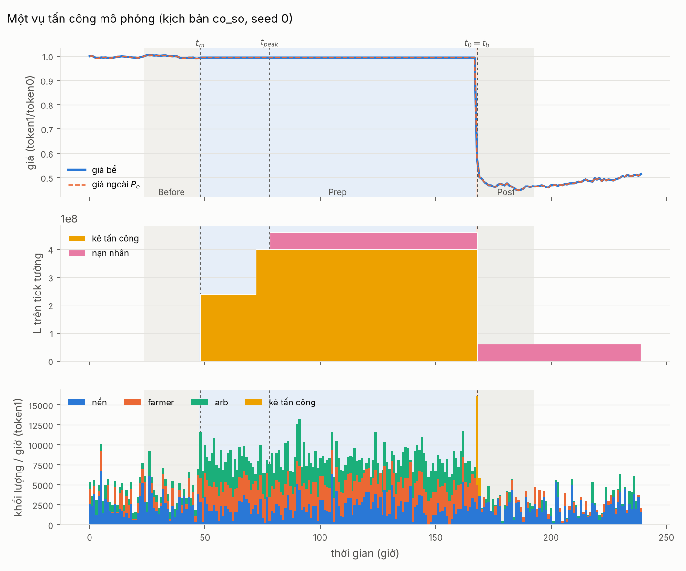
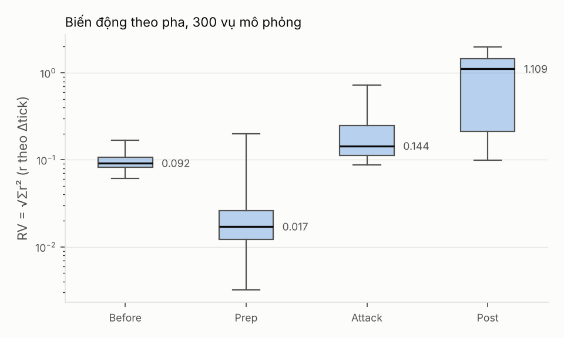
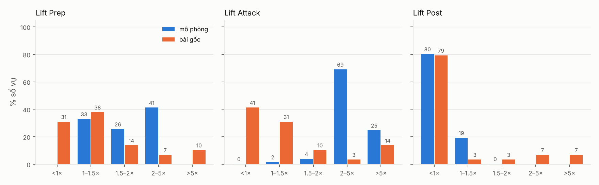
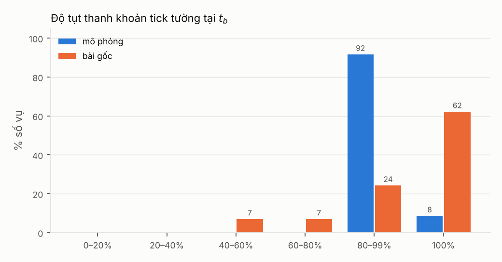

# 6. Kết quả tái lập (RQ1) — bản nháp

> Bản nháp của B, 15/10/2026. Số liệu từ `ket_qua/rq1/` (sinh lại: `python -m metrics.chay_rq1`, ≈ 60 s; hình: `python -m plots.ve_rq1`). Bộ dữ liệu: 30 cấu hình × 10 seed = 300 lượt mô phỏng trên engine cross-tick, có đuôi thanh khoản nền toàn dải (`bg_tail` = 0,075), dòng ngẫu nhiên riêng cho từng cấu hình (CH-8); 295 lượt có sập. Khoảng tin cậy 95%: bootstrap phân cụm theo cấu hình (mục 5.5). Bài gốc: 29 vụ thật trên BSC.

**Simulator tái lập được cả mười một dấu hiệu thực nghiệm chính của bài gốc** (Bảng 6.1): tường ghim giá, khối lượng sau sập rơi dưới nền ở 80% lượt (CI 71–88%; bài gốc 79%), biến động thấp nhất lúc chuẩn bị và cao nhất sau sập, tường cạn tại thời điểm sập. Phân phối khớp sát nhất ở khối lượng Post; lệch rõ nhất ở khối lượng Prep và Attack (mục 6.3). Dấu hiệu yếu nhất là "giá sập < −10% theo VWAP": tỷ lệ 52% nhưng cận dưới CI 38% < 50% (bài gốc 69% vẫn nằm trong CI).

## 6.1 Bảng kiểm định

**Bảng 6.1.** Tỷ lệ lượt thỏa từng phát biểu của bài gốc, kèm CI 95% (bootstrap phân cụm: lấy lại cấu hình, trong mỗi cấu hình lấy lại seed). Đạt khi tỷ lệ mô phỏng ≥ 50% (riêng "Attack > 5×": có ít nhất một lượt).

| Dấu hiệu | Phát biểu | Mô phỏng (CI 95%) | Bài gốc | Kết quả |
|---|---|---|---|---|
| Sập | giá ≤ 90% tick tường | 98% (96–100) | 100% | Đạt |
| Chuẩn bị theo ngày | Δbuild ≥ 1 ngày | 100% | 55% | Đạt* |
| Thu hoạch theo giờ | Δextract < 24 giờ | 99% (97–100) | 62% | Đạt |
| Khối lượng Attack | lift ≥ 1× | 100% (99–100) | 59% | Đạt |
| | có vụ lift > 5× | 25% (12–40) | 14% | Đạt |
| **Khối lượng Post** | **lift < 1×** | **80% (71–88)** | **79%** | **Đạt** |
| | (phụ, bỏ arbitrageur) | 68% (58–78) | — | Đạt |
| Biến động | RV Prep < RV Attack | 97% (90–100) | — | Đạt |
| | RV Post cao nhất | 96% (91–100) | — | Đạt |
| Giá ghim quanh `t_m` | \|độ dời\| < 10% | 100% | 79% | Đạt |
| Giá sập sau rút | độ dời < −10% (VWAP) | 52% (38–67) | 69% | Đạt (mong manh) |
| | (phụ, mốc trước burn) | 79% (67–91) | — | Đạt |
| Tường cạn | drop tại `t_b` ≥ 80% | 100% | 86% | Đạt |
| Victim khớp lý thuyết | `L_V*/L_A ≈ 1` tại `L_A = fQ/(4c_V)` | kiểm ở lớp cơ học | — | Đạt (test) |

\* Δbuild = 120 giờ ở mọi lượt vì lịch dựng và rút tường là tham số kịch bản (`t_m` = 48, `t_0` = 168), không phải kết quả nội sinh. Dòng này chỉ xác nhận thiết kế kịch bản nằm trong miền bài gốc quan sát.

Seed giờ độc lập giữa các cấu hình: tỷ lệ Post < 1× theo seed dao động 67–93% (độ lệch chuẩn 7,7 điểm %, đúng mức nhiễu nhị thức 7,4 điểm % của 30 lượt), seed 0–4 và 5–9 không khác nhau (kiểm định hoán vị trong cấu hình, p = 0,66). Bootstrap chéo cấu hình × seed cho khoảng gần trùng bootstrap lồng nhau (ví dụ Post < 1×: 70–90% so với 71–88%), nên bảng chỉ báo khoảng lồng nhau.

## 6.2 Diễn biến một vụ và động lực theo pha

**Hình 6.1.** Một vụ trong kịch bản cơ sở (seed 0). Trên: giá bể và giá ngoài. Giữa: thanh khoản tick tường của kẻ tấn công và nạn nhân. Dưới: khối lượng swap mỗi giờ theo vai.

Hình 6.1 cho thấy đủ trình tự bài gốc mô tả. Kẻ tấn công dựng tường 2,4·10⁸ L ở giờ 48, nâng lên 4·10⁸ ở giờ 72; nạn nhân toàn tri vào ở giờ 78 với phần nhỏ hơn tường. Suốt 120 giờ Prep, giá đứng yên trong một tick trong khi farmer và arbitrageur giao dịch đều. Ở giờ 168 kẻ tấn công rút toàn bộ tường rồi xả; giá rơi từ 1,0 xuống 0,5 trong cùng giờ, nên `t_0 = t_b`. Sau đó chỉ còn phần của nạn nhân kẹt trên tick, và khối lượng mỗi giờ thấp hơn trước khi có tường.

**Hình 6.2.** Biến động thực hiện theo pha, 300 lượt (trục log; râu = min–max).

Trung vị RV theo pha là 0,092 (Before), 0,017 (Prep), 0,144 (Attack) và 1,109 (Post). Prep yên hơn cả Before vì tường hấp thụ dòng lệnh mà không đổi tick. Post cao nhất vì sau sập giá ra khỏi dải thanh khoản nền, chỉ còn đuôi mỏng: `L_active` trung vị giảm từ 215.000 (Before) xuống 15.000 (Post), tức còn 7%.

## 6.3 Phân phối so với bài gốc

**Hình 6.3 (Bảng 4 bài gốc).** Phân bố volume lift theo nhóm, % số vụ.

| Nhóm | Prep MP | Prep BG | Attack MP | Attack BG | Post MP | Post BG |
|---|---|---|---|---|---|---|
| < 1× | 0 | 9 | 1 | 12 | 237 | 23 |
| 1–1,5× | 99 | 11 | 5 | 9 | 57 | 1 |
| 1,5–2× | 77 | 4 | 12 | 3 | 1 | 1 |
| 2–5× | 124 | 2 | 204 | 1 | 0 | 2 |
| > 5× | 0 | 3 | 73 | 4 | 0 | 2 |

MP = mô phỏng (Prep: 300 lượt; Attack, Post: 295 lượt có sập), BG = bài gốc (29 vụ). Post khớp sát về tỷ lệ dưới nền (80% so với 79%). Hai chỗ lệch cần nói rõ:

- **Prep không lượt nào dưới nền** (0/300; bài gốc 9/29), trung vị lift Prep 1,79 (CI 1,51–2,18). Chúng tôi **giữ nguyên, không hiệu chỉnh**, và coi đây là khác biệt có giải thích. Theo Theorem 1, tường giảm chi phí trượt giá `MC(v)` nên farmer duy lý giao dịch tới trần trợ cấp ngay khi tường xuất hiện; khối lượng Prep vì thế tăng theo trần `Q`: trung vị 1,37 / 1,84 / 3,06 với `Q` = 12k / 24k / 48k. Nhóm `Q` = 12k gần bài gốc nhất (trung vị 1,37, CI 1,17–1,48; 76% lượt < 1,5×, bài gốc 69%). Chỉ số phụ bỏ arbitrageur `lift_trade_Prep` có trung vị 1,50 (1,22 ở nhóm `Q` = 12k). Lift Prep < 1× ở bài gốc phản ánh khối lượng nền ngoài đời giảm hoặc nhiễu, thứ không có trong lý thuyết; ép mô hình khớp sẽ phải thêm nhiễu ngoại sinh không có căn cứ.
- **Attack dồn vào 2–5×** (69% lượt; bài gốc 41% dưới nền). Trong mô phỏng toàn bộ cú xả đi qua đúng bể bị tấn công; trên chuỗi thật kẻ tấn công có thể bán qua nhiều bể và sàn, nên khối lượng trong bể không bùng đều như vậy.

**Hình 6.4 (Bảng 7 bài gốc).** Độ tụt thanh khoản tick tường tại `t_b`.

Mọi lượt mô phỏng cạn ≥ 80% (bài gốc 25/29), nhưng 92% (270/295) rơi vào nhóm 80–99% thay vì 100% (bài gốc 18/29 ở 100%). Lý do: nạn nhân toàn tri không rút trước khi sập, phần của họ vẫn nằm trên tick. Ở bài gốc, `L(t_b) = 0` thường xuyên hơn, gợi ý nạn nhân thật nhỏ hơn hoặc một phần đã rút.

**Độ dời giá (Bảng 6 bài gốc).** Quanh `t_m`: 187/300 lượt trong 0–10%, 113 lượt trong −10–0% (bài gốc 16 và 7). Sau rút, theo VWAP: 40 lượt −50…−20%, 113 lượt −20…−10%, 142 lượt −10…0% (bài gốc 10 / 10 / 8). Mốc VWAP giờ `t_0` đã gồm cú xả nên ước thấp độ sập; với mốc trước burn tường, trung vị độ dời là −13,8% thay vì −10,2%, và 79% lượt dưới −10%.

## 6.4 Bốn chỉ số

| Chỉ số (token1) | P10 | Trung vị | P90 |
|---|---|---|---|
| Thiệt hại nạn nhân, bản đầy đủ | 16 | 171 | 671 |
| Thiệt hại nạn nhân, bản bài gốc (non-alpha) | 0 | 0 | 0 |
| Lợi nhuận kẻ tấn công, bản bài gốc (`paper`) | 11.924 | 14.532 | 20.488 |
| **Lợi nhuận tăng thêm so với bán thẳng (`excess`)** | 29 | 299 | 1.092 |
| Lợi nhuận kẻ tấn công, bản đầy đủ (`c_A` = 0,5) | 5.825 | 9.607 | 13.411 |
| Chi phí trợ cấp | 1.214 | 4.722 | 16.497 |
| Tỷ lệ rò rỉ (bản bài gốc) | 1,1× | 3,2× | 11,7× |
| Tỷ lệ rò rỉ (tăng thêm) | 0,01× | 0,06× | 0,34× |
| Tỷ lệ rò rỉ (bản đầy đủ) | 0,7× | 1,9× | 6,1× |

Lợi nhuận bản bài gốc gần như toàn bộ là tiền xả kho vào thanh khoản nền: bán thẳng cùng lượng alpha vào bể không tường, không nạn nhân thu được 97,8% (trung vị) số đó. Phần **tăng thêm nhờ tấn công** (Theorem 6) chỉ có trung vị 299 token1 (CI 146–602), dương ở 277/295 lượt, giảm theo `k` (756 / 336 / 100 tại `k` = 0,64 / 0,80 / 0,95) — cùng chiều với thiệt hại nạn nhân, vì phần tăng thêm chính là thanh khoản nạn nhân bị xả vào. Khi không có nạn nhân, `excess` bằng 0 đúng (kiểm trong test). Như vậy, so với bán thẳng, kẻ tấn công chỉ thu thêm trung vị 6% chi phí trợ cấp (CI 3–13%); tỷ lệ rò rỉ bản bài gốc (3,2×) phóng đại mức độ trợ cấp bị chuyển cho kẻ tấn công. Hiệu quả chi tiêu âm ở mọi lượt (`eff_gain` trung vị −36 L mỗi token1): thanh khoản sau tấn công thấp hơn trước khi có trợ cấp.

Thiệt hại nạn nhân bản bài gốc gần như luôn bằng 0 (chỉ 9% lượt dương), vì cách tính này trừ toàn bộ alpha nhận lại, kể cả alpha nạn nhân tự nạp. Bản đầy đủ dương ở 92% lượt. Thiệt hại giảm khi chi phí tham gia của nạn nhân tăng (`k` = 0,64 / 0,80 / 0,95 cho trung vị 531 / 241 / 47), vì nạn nhân góp ít hơn. Có 25/295 lượt không xác định được nạn nhân (không ai còn thanh khoản trên tick tại `t_b`); cần xem log để biết nạn nhân không vào hay đã rút.

## 6.5 Giới hạn và khác biệt với bài gốc

- **Lift Prep cao hơn bài gốc — giữ, không hiệu chỉnh** (mục 6.3): hệ quả trực tiếp của Theorem 1 với farmer duy lý; nhóm `Q` = 12k gần bài gốc nhất; báo kèm chỉ số phụ `lift_trade_Prep`.
- 10 seed mỗi cấu hình, 30 cấu hình: sai số của một tỷ lệ tới ±~18 điểm % (mục 5.5); "giá sập < −10% (VWAP)" có CI vắt qua ngưỡng 50%.
- Lịch dựng và rút tường cố định nên dấu hiệu thời gian chỉ là kiểm tra thiết kế, không phải kết quả.
- Nạn nhân toàn tri là cận trên của khả năng phản ứng; nạn nhân thích nghi có thể làm Bảng 7 gần bài gốc hơn.
- Phản thực bán thẳng dựng bể tại thời điểm ngay trước rút tường (giá đã ghim ở tick tường); không mô phỏng phản ứng của trader nền nếu không có tường.
