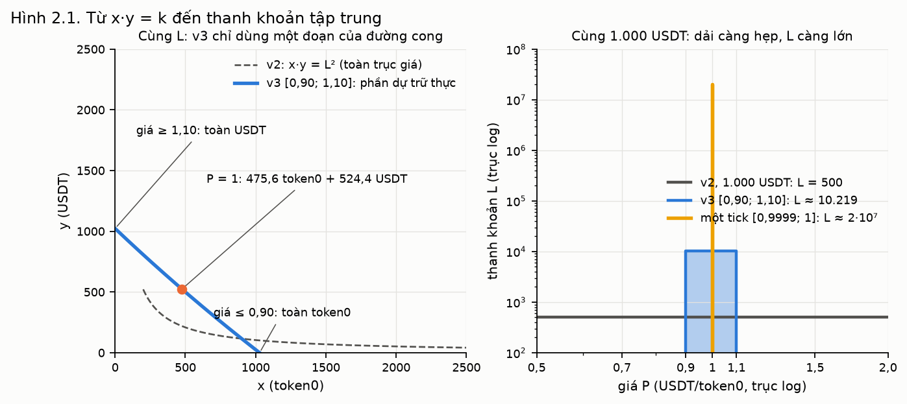
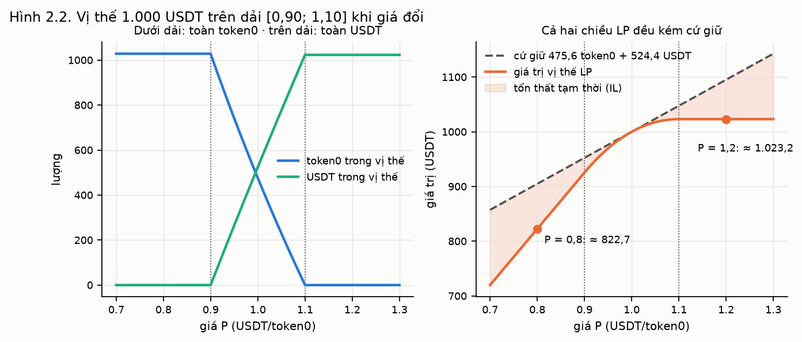
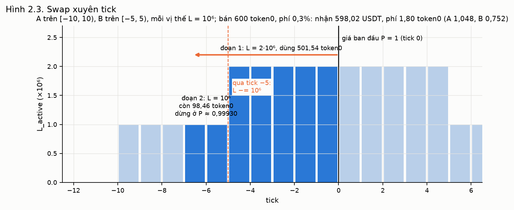
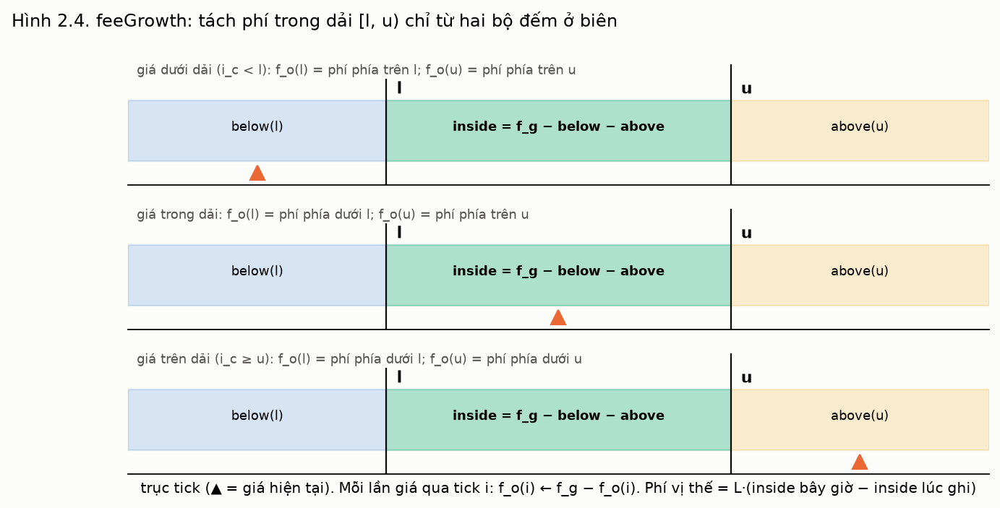
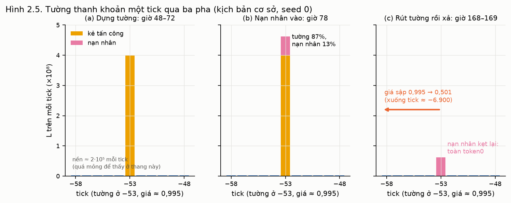
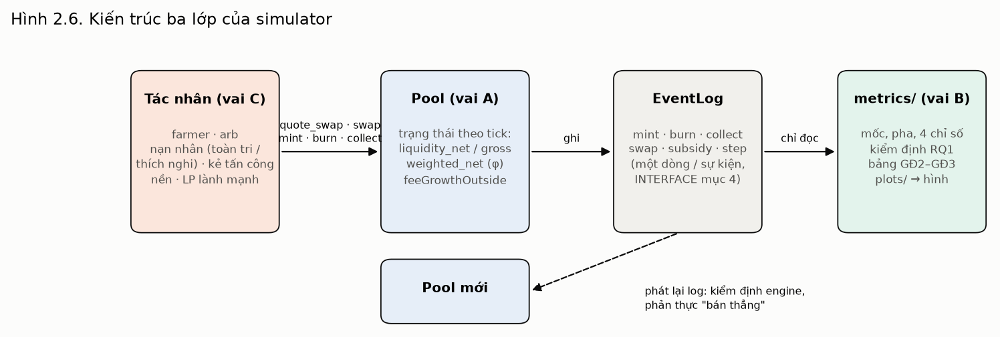

# 2. Nền tảng CLMM (Concentrated Liquidity Market Maker)

> Bản nháp của vai A (Engine), 15/10/2026. Viết cho người đọc chưa quen Uniswap v3. Mọi ví dụ số trong mục này đã được tính lại bằng chính engine của đồ án (`engine/`), phí 0,3% trừ khi ghi khác. Sáu hình sinh bằng `python -m plots.ve_nen_tang` → `ket_qua/nen_tang/` (17/10). Quy ước xuyên suốt: **token0** là token phụ (alpha), **token1** là token định giá (USDT); giá `P` = số token1 đổi được một token0; `z = √P`.

---

## 2.1 Từ AMM `x·y = k` đến thanh khoản tập trung

**AMM tích hằng số (Uniswap v2, Adams et al. 2020).** Bể giữ `x` token0 và `y` token1, mọi giao dịch phải giữ `x·y = k`. Giá biên là `P = y/x`. Đặt `L = √k` thì

```
x = L/√P ,   y = L·√P ,   L = √(x·y)
```

`L` (thanh khoản) là "độ sâu" của bể: `L` càng lớn, một lệnh cùng cỡ làm giá dịch càng ít. Điểm yếu là vốn **rải đều trên toàn trục giá `(0, ∞)`**: muốn có độ sâu `L` quanh giá 1 USDT, LP phải nạp `x = y = L`, tức giá trị `2L` USDT, trong khi phần lớn số vốn đó chỉ được dùng nếu giá đi tới 0,01 hay 100 — gần như không bao giờ.

**Thanh khoản tập trung (Uniswap v3, Adams et al. 2021).** Mỗi LP chọn một dải giá `[p_a, p_b]` và chỉ cung cấp độ sâu trong dải đó. Bên trong dải, vị thế cư xử như một bể v2 với **dự trữ ảo**:

```
(x + L/√p_b) · (y + L·√p_a) = L²
```

tức đường cong `x·y = L²` bị tịnh tiến sao cho vị thế cạn token0 đúng tại `p_b` và cạn token1 đúng tại `p_a`. Ngoài dải, vị thế không tham gia giao dịch và không nhận phí.

**Hiệu quả vốn — ví dụ số.** Cùng 1.000 USDT, giá hiện tại `P₀ = 1`:

| Cách đặt vốn | `L` đạt được | Vốn v2 cần để có cùng `L` | Hệ số hiệu quả vốn |
|---|---|---|---|
| v2, toàn trục | 500 | 1.000 USDT | 1× |
| v3, dải `[0,90 ; 1,00]` | ≈ 19.487 | ≈ 38.974 USDT | ≈ 39× |
| v3, **một tick** `[0,9999 ; 1,00]` | ≈ 20.001.500 | ≈ 40 triệu USDT | ≈ **40.000×** |

Dải càng hẹp, cùng một số vốn mua được càng nhiều `L` — nhưng chỉ khi giá còn nằm trong dải. Đây vừa là lý do CLMM hấp dẫn (trượt giá thấp, phí trên mỗi đồng vốn cao) vừa là gốc của tấn công trong bài gốc: một "tường" một tick cho trượt giá gần 0 với vốn nhỏ. Bán 100 token0 vào dải `[0,90 ; 1,00]` (L ≈ 19.487) làm giá giảm ≈ 1,02%; bán cùng lượng đó vào tường một tick (L ≈ 2·10⁷) chỉ làm giá giảm ≈ 0,001%.



**Hình 2.1.** Trái: đường cong x·y = L² của v2 và đoạn dự trữ thực của vị thế v3 [0,90; 1,10] cùng L ≈ 10.219 (chấm cam: trạng thái tại P = 1). Phải: thanh khoản L theo giá của ba cách đặt cùng 1.000 USDT (v2, dải [0,90; 1,10], một tick), trục log.

---

## 2.2 Tick, √P, L và lượng token trong vị thế

**Tick.** Trục giá được chia rời rạc bởi `P(i) = 1,0001^i` với `i` nguyên (`|i| ≤ 887.272`), mỗi tick cách nhau 0,01% (1 bps). Biên vị thế phải là bội của `tickSpacing` (trên Uniswap v3: 10 cho bể phí 0,05%, 60 cho 0,3%, 200 cho 1%). Trên PancakeSwap v3 (BSC, nơi xảy ra 29 vụ của Lu et al. 2026), theo mã nguồn `PancakeV3Factory.sol` (`feeAmountTickSpacing`, repo `pancakeswap/pancake-v3-contracts`, `projects/v3-core`):

| Mức phí (tier) | 0,01% | 0,05% | 0,25% | 1% |
|---|---|---|---|---|
| `tickSpacing` | 1 | 10 | 50 | 200 |
| Độ rộng vị thế hẹp nhất (theo giá) | ≈ 0,01% | ≈ 0,1% | ≈ 0,5% | ≈ 2% |

Tick hiện tại là `i_c = ⌊log_{1,0001} P⌋`, tức `z(i_c) ≤ z < z(i_c + 1)`.

> **Ghi chú về "tường một tick" và tham số của simulator.** Bài gốc không nêu mức phí của 29 vụ; "mỗi tick 0,01%" chỉ là ví dụ minh họa. "Tường một tick" theo nghĩa đen (một spacing = 1 tick = 0,01% giá) chỉ có ở tier 0,01%; ở các tier khác, vị thế hẹp nhất là một *spacing* (10, 50 hoặc 200 tick). Simulator dùng `f = 0,25%` với `tickSpacing = 1`. Cặp này không có thật trên PancakeSwap, đó là một trừu tượng hóa: mô hình của bài gốc cũng tách mức phí `f` khỏi độ rộng tick (Giả định 2 chỉ cần mọi giao dịch được trợ cấp nằm trong tường). Các kết quả chính của đồ án được biểu diễn qua đại lượng không thứ nguyên `k = c_V·L_A/(f·V)` và `σ/f`, nên không phụ thuộc trực tiếp vào cặp `(f, spacing)`. Ngược lại, các **con số tuyệt đối** (lợi nhuận tính bằng USDT, độ sâu, số tick giá sập) thì có phụ thuộc, nên chỉ dùng để so sánh trong cùng một cấu hình.

**Vì sao dùng `z = √P`.** Trong một đoạn có `L` không đổi, lượng token thay đổi **tuyến tính** theo `z` và `1/z`:

```
Δy = L · Δz                       (token1, khi giá đi từ z_a tới z_b)
Δx = L · Δ(1/z) = L·(1/z_a − 1/z_b)   (token0)
```

Hai công thức này là `amount1_delta`, `amount0_delta` trong `engine/tick_math.py`. Nhờ tuyến tính, mỗi bước swap có nghiệm dạng đóng, không cần giải phương trình.

**Thành phần của một vị thế `[z_l, z_u)` có thanh khoản `L` khi giá là `z`** (`amounts_for_liquidity`):

| Vị trí giá | token0 (`x`) | token1 (`y`) | Ý nghĩa |
|---|---|---|---|
| `z ≤ z_l` (giá **dưới** dải) | `L·(1/z_l − 1/z_u)` | 0 | toàn token0 — LP đã "mua" hết token0 trên đường giá đi xuống |
| `z_l < z < z_u` (**trong** dải) | `L·(1/z − 1/z_u)` | `L·(z − z_l)` | hỗn hợp, đang hoạt động, nhận phí |
| `z ≥ z_u` (giá **trên** dải) | 0 | `L·(z_u − z_l)` | toàn token1 |

Ngược lại, từ số vốn tính ra `L` (`liquidity_for_amounts`): ví dụ 1.000 USDT đặt ngay dưới `P₀ = 1` (giá ở biên trên, vị thế toàn token1) thì `L = 1000/(z_u − z_l)`:
- dải `[0,90 ; 1,00]`: `L = 1000/(1 − √0,9) ≈ 19.487`;
- một tick `[−1, 0)`, `z_l = 1,0001^{−1/2} ≈ 0,99995`: `L = 1000/(1 − 0,99995) ≈ 20.001.500` — đúng yêu cầu kiểm định của phân công ("≈ 2·10⁷"), test `test_vi_du_phan_cong_1000_usdt_mot_tick`.

**Ví dụ ba trạng thái.** 1.000 USDT vào dải `[0,90 ; 1,10]` khi `P = 1`: `L ≈ 10.219`, vị thế giữ ≈ 475,6 token0 + 524,4 USDT.
- Giá xuống `P = 0,8` (dưới dải): vị thế thành ≈ 1.028,4 token0, trị giá ≈ 822,7 USDT.
- Giá lên `P = 1,2` (trên dải): vị thế thành ≈ 1.023,2 USDT, trong khi cứ giữ nguyên 475,6 token0 + 524,4 USDT sẽ đáng ≈ 1.095 USDT.

Cả hai chiều LP đều kém "cứ giữ token" — đó là tổn thất tạm thời (IL), mục 2.5. Với tường một tick, giá chỉ cần đi 0,01% là vị thế đã đổi **toàn bộ** sang token còn lại: 1.000 USDT ở tick `[−1, 0)` thành ≈ 1.000,05 token0 ngay khi giá xuống dưới 0,9999; nếu giá sau đó sập còn 0,5 thì phần đó chỉ còn ≈ 500 USDT. Đây chính là cơ chế thiệt hại của nạn nhân trong bài gốc.



**Hình 2.2.** Vị thế 1.000 USDT trên [0,90; 1,10] (L ≈ 10.219) khi giá đi từ 0,7 tới 1,3. Trái: lượng token0 và USDT, gãy đúng ở hai biên. Phải: giá trị vị thế so với cứ giữ 475,6 token0 + 524,4 USDT; phần tô là tổn thất tạm thời.

---

## 2.3 Swap xuyên tick

Trạng thái bể không lưu từng vị thế khi swap; nó lưu **theo tick**:
- `L_active` — tổng `L` của các vị thế đang chứa giá hiện tại;
- với mỗi tick đã khởi tạo `i` (là biên của ít nhất một vị thế): `liquidityNet(i)` = lượng cộng vào `L_active` khi giá đi **lên** qua `i` (vị thế nhận `i` làm biên dưới đóng góp `+L`, nhận làm biên trên đóng góp `−L`) và `liquidityGross(i)` để biết khi nào xóa tick.

**Vòng lặp swap** (bản rút gọn của `_swap_core` trong `engine/pool.py`, theo `UniswapV3Pool.swap` + `SwapMath.computeSwapStep`):

```
còn = lượng vào (đã gồm phí);  z, tick, L = trạng thái hiện tại
lặp khi còn > 0 và chưa tới giá giới hạn:
    nxt    = tick đã khởi tạo kế tiếp theo chiều đi         (tìm nhị phân trên danh sách tick)
    đích   = z(nxt), hoặc giá giới hạn nếu gần hơn
    nếu L > 0:
        cần = lượng vào (gồm phí) để đưa giá từ z tới đích     (Δx hoặc Δy ở 2.2, chia (1−f))
        nếu còn ≥ cần:  z ← đích,  dùng hết "cần"
        ngược lại:      ròng = còn·(1−f);  z ← nghiệm đóng:
                          bán token0: 1/z' = 1/z + ròng/L      mua token0: z' = z + ròng/L
        phí bước = phần vào − phần ròng;   feeGrowthGlobal += phí bước / L
    nếu L = 0:  z ← đích (khoảng trống: giá nhảy qua, không tốn token)
    nếu z chạm đúng z(nxt):  QUA TICK
        đi lên:  L += liquidityNet(nxt);  tick = nxt
        đi xuống: L −= liquidityNet(nxt); tick = nxt − 1
        lật feeGrowthOutside(nxt)                             (mục 2.4)
```

Số vòng lặp tỷ lệ với số **tick đã khởi tạo** bị vượt qua, không phải số tick giá đi qua — vượt 2.900 tick trống chỉ tốn một bước.

**Ví dụ số.** Hai vị thế quanh `P = 1`: A trên `[−10, 10)` và B trên `[−5, 5)`, mỗi vị thế `L = 10⁶`; `L_active = 2·10⁶`. Bán 600 token0:
1. Đoạn 1, `L = 2·10⁶`, từ `z = 1` tới `z(−5)`: cần `2·10⁶·(1/z(−5) − 1)/0,997 ≈ 501,54` token0. Đủ → qua tick −5: `L −= liquidityNet(−5) = +10⁶` → `L = 10⁶`.
2. Đoạn 2, `L = 10⁶`: còn 98,46 token0, ròng 98,16, giá dừng giữa đoạn ở `P ≈ 0,99930` (tick −7).

Kết quả: nhận 598,02 token1, phí 1,80 token0; A nhận 1,048 (nửa phí đoạn 1 + toàn bộ phí đoạn 2), B nhận 0,752 (chỉ nửa phí đoạn 1). Nếu bán 800 token0 thì sau ≈ 752,38 token0 bể hết thanh khoản phía dưới (`L = 0` sau tick −10), swap dừng và trả lại phần thừa — engine xử lý giống v3.

**Quy ước biên.** Đi xuống chạm đúng biên tick `i` đã khởi tạo thì `tick = i − 1` dù giá đang nằm đúng `z(i)` (giá ở **mép trên** của tick `i − 1`). Hệ quả thực tế: tường `[−1, 0)` đặt ngay dưới `P₀ = 1` chưa hoạt động, nhưng kích hoạt ngay khi có lệnh bán đầu tiên (test `test_tuong_ngay_duoi_gia_kich_hoat_khi_ban`). Lỗi #9 trong `TONG_KET_DU_AN.md` (tác nhân lấy `tick_lower = pool.tick`) bắt nguồn từ quy ước này.



**Hình 2.3.** L_active theo tick trong ví dụ hai vị thế A [−10, 10) và B [−5, 5). Bán 600 token0 đi hết đoạn L = 2·10⁶ tới tick −5 (501,54 token0), qua tick −5 thì L giảm còn 10⁶, rồi dừng ở P ≈ 0,99930 (tick −7).

---

## 2.4 Phí và feeGrowth

**Nguyên tắc chia phí (pro-rata theo `L`).** Mỗi đoạn swap trả phí `f·Δin`; phí đó chia cho các vị thế đang chứa giá theo tỷ lệ `L_i / L_active`. Lưu phí cho từng vị thế sau mỗi swap tốn `O(số vị thế)`; v3 tránh việc đó bằng bộ đếm tích lũy:

- `feeGrowthGlobal` (`f_g`): tổng phí trên **mỗi đơn vị `L`** từ đầu đến nay (mỗi đoạn cộng `phí/L_active`).
- `feeGrowthOutside(i)` (`f_o(i)`): phần `f_g` tích lũy ở **phía bên kia** tick `i` so với giá hiện tại. Khởi tạo: `f_o(i) = f_g` nếu `i ≤ i_c` (quy ước coi mọi phí cũ nằm dưới), ngược lại 0. Mỗi lần giá **qua** tick `i`: `f_o(i) ← f_g − f_o(i)` (lật phía).
- Phí trong dải `[l, u)`:

```
f_below(l) = f_o(l)        nếu i_c ≥ l,   ngược lại f_g − f_o(l)
f_above(u) = f_o(u)        nếu i_c < u,   ngược lại f_g − f_o(u)
f_inside(l, u) = f_g − f_below(l) − f_above(u)
```

- Mỗi vị thế lưu **checkpoint** `f_inside,last` lúc mint/collect gần nhất; phí được hưởng = `L · (f_inside − f_inside,last)`. Giá trị tuyệt đối của `f_inside` vô nghĩa (phụ thuộc quy ước khởi tạo); chỉ **hiệu** giữa hai thời điểm là có nghĩa.



**Hình 2.4.** feeGrowthOutside với ba vị trí giá (dưới / trong / trên dải [l, u)): f_o(l), f_o(u) luôn là phí ở phía bên kia biên so với giá, nên phí trong dải = f_g − below(l) − above(u).

**Vì sao LP vào sau làm loãng phí.** Phí trên mỗi đơn vị `L` là `phí/L_active`: thêm `L` mới không tạo thêm phí (khối lượng `V` do trader quyết định), chỉ chia mỏng phần có sẵn. Ví dụ: LP1 có `L = 10⁶` trên `[−10, 10)`; trader bán 100 token0 → phí 0,30 token0, LP1 nhận đủ. LP2 nạp thêm `L = 10⁶` cùng dải; trader mua lại bằng 100 token1 → phí 0,30 token1, mỗi bên 0,15. LP2 không nhận gì của swap trước (checkpoint lúc mint), nhưng từ đó LP1 chỉ còn nửa. Trong bài gốc, lợi nhuận nạn nhân `Π_V = f·Q·L_V/(L_A + L_V) − c_V·L_V` có đúng dạng này: tường `L_A` lớn là "LP vào trước" chiếm phần lớn phí, và nạn nhân vào càng nhiều thì lợi suất của chính họ càng giảm (Lemma 4).

**Mở rộng: chia phí có trọng số `φ(w)` (range-aware, GĐ3).** Quyết định chốt số 6 của đồ án: phí của mỗi đoạn chia theo

```
phần của vị thế i = L_i·φ(w_i) / Σ_j L_j·φ(w_j)      (tổng trên các vị thế đang chứa giá)
```

với `w = tick_upper − tick_lower` (số tick), ví dụ `φ(w) = min(1, (w/w₀)^α)`. Tổng phí trader trả **không đổi**, giá và lượng swap **không đổi** (vẫn đi theo `L` thật) — chỉ cách chia thay đổi. Cài đặt trong engine chỉ cần đổi "đơn vị" của feeGrowth:
- mỗi tick lưu thêm `weighted_net(i)` (như `liquidityNet` nhưng cộng `L·φ(w)`), bể lưu `liquidity_weighted = Σ L·φ` đang hoạt động, cập nhật song song với `L_active` khi qua tick;
- mỗi đoạn: `f_g += phí / liquidity_weighted` (phí trên mỗi đơn vị `L·φ`), thay vì `/ L_active`;
- phí vị thế: `L_i·φ(w_i)·(f_inside − f_inside,last)`; `φ` tính **một lần** lúc mint.

Toàn bộ cơ chế outside/inside giữ nguyên, nên chi phí tính toán không đổi về bậc (đo được chậm 1,0–1,3× so với pro-rata). `φ ≡ hằng số` cho đúng pro-rata (hằng số triệt tiêu trong tỷ lệ) — vì vậy ở GĐ1, khi mọi vị thế cùng một tick, range-aware vô hiệu (quyết định chốt số 7).

Ví dụ: tường A một tick `L = 2·10⁷` và nạn nhân V trải `w = 100` tick với `L = 2·10⁵`, `φ(w) = min(1, w/100)`. Pro-rata: V nhận `2·10⁵/(2,02·10⁷) ≈ 1%` phí. Có `φ`: `L·φ` của A còn `2·10⁷·0,01 = 2·10⁵`, bằng của V → mỗi bên 50%.

---

## 2.5 Rủi ro của LP liên quan đến đồ án

**Tổn thất tạm thời (IL) và LVR.** IL là chênh lệch giữa giá trị vị thế và giá trị "cứ giữ token" (ví dụ ở 2.2). Heimbach, Schertenleib và Wattenhofer (AFT 2022) đưa công thức IL cho vị thế v3 và chỉ ra IL tăng nhanh hơn khi thanh khoản càng tập trung; lãi lớn trên v3 đòi hỏi quản lý chủ động, bất lợi cho LP nhỏ lẻ. Loesch et al. (2021) đo trên 17 bể v3 (43% TVL): tổng phí 199,3 triệu USD nhỏ hơn tổng IL 260,1 triệu USD, 49,5% LP lỗ. Milionis, Moallemi, Roughgarden và Zhang (arXiv 2208.06046, 2022; bản v6 2026) định nghĩa **LVR** — khoản lỗ của LP cho arbitrageur so với danh mục tái cân bằng ở giá thị trường; với vị thế một dải, LVR trên mỗi đô-la vốn **tăng không giới hạn khi dải hẹp lại**. Fritsch và Canidio (2024) đo được lỗ cho arbitrageur vượt phí ở nhiều bể lớn, và bể v3 kém sinh lời cho LP thụ động hơn bể v2. → Vị thế một tick của nạn nhân là dạng nhạy nhất với biến động; nạn nhân bị hút vào chỉ vì lợi suất hiển thị (phí do trợ cấp sinh ra) cao bất thường.

**Thanh khoản Just-in-Time (JIT).** Kẻ JIT thấy một lệnh lớn trong mempool, mint vị thế cực hẹp ngay trước, burn ngay sau, cùng block. Xiong et al. (2023) đo 36.671 vụ trên Ethereum: > 99,99% vị thế JIT phủ **đúng một tickSpacing**, kẻ JIT chiếm trung bình 85% thanh khoản trong khoảng (tức ~85% phí của swap đó). Trotti et al. (2025) tối ưu JIT ở mức giao dịch, cho thấy JIT có thể cắt phí của LP thụ động tới 44%. Capponi, Jia và Zhu (2023) chứng minh JIT có thể làm *giảm* tổng thanh khoản và đề xuất phí hai tầng chuyển một phần phí của LP ngắn hạn sang LP dài hạn — phân loại theo **thời gian nắm giữ**. JIT chính là cơ chế loãng phí ở 2.4 đẩy tới cực hạn.

**Tường thanh khoản một tick do khuyến khích (Lu et al., USENIX Security 2026).** Cùng "nguyên thủy" vị thế một tick như JIT, nhưng giữ **nhiều ngày** và nhắm vào chương trình trợ cấp khối lượng: tường làm trượt giá ≈ 0 → trader săn điểm giao dịch tới trần `Q` → phí cao → nạn nhân vào cùng tick → kẻ tấn công rút tường và xả token0 qua thanh khoản của nạn nhân. Bài gốc tìm 29 vụ trên BSC, ở 25/29 vụ tường chiếm ≥ 80% thanh khoản tick. Vì tường tồn tại nhiều ngày, phí hai tầng theo thời gian của Capponi et al. xếp nó vào nhóm "dài hạn" và không phân biệt được; Tang et al. (2025) chứng minh với chia phí pro-rata thì độ rộng vị thế tự nó không mang thông tin ("twin games": vị thế `w` tick ≡ `w` vị thế một tick). Hai điểm này là lý do đồ án thử chia phí theo **độ rộng** `φ(w)` ở GĐ3.



**Hình 2.5.** Tường một tick qua ba pha, số của kịch bản cơ sở seed 0: (a) kẻ tấn công dựng tường 4·10⁸ ở tick −53; (b) nạn nhân vào 0,62·10⁸ (tường vẫn chiếm 87%); (c) tường rút, cú xả đưa giá từ 0,995 xuống 0,501, phần nạn nhân kẹt lại thành toàn token0.

---

## 2.6 Engine của đồ án

**Thiết kế.** Ba tệp chính, ≈ 500 dòng Python:

```
engine/
├── tick_math.py   tick ↔ √P, amount0/1_delta, amounts_for_liquidity, liquidity_for_amounts
├── pool.py        Pool: mint / burn / collect / swap / quote_swap / position_amounts / fees_owed
│                  trạng thái theo tick: liquidity_net, liquidity_gross, weighted_net, feeGrowthOutside
│                  _sorted_ticks (danh sách tăng dần + bisect) thay cho tick bitmap
└── log.py         EventLog: mỗi mint/burn/collect/swap một dòng đúng INTERFACE mục 4
```

- Vị thế tổng quát `Position(id, owner, tick_lower, tick_upper, liquidity)`, độ rộng bất kỳ, `tick_spacing ≥ 1` (quyết định chốt 1, 2: cross-tick từ GĐ1, không hardcode một tick).
- `swap` theo lượng vào (đã gồm phí) và/hoặc giá giới hạn, dừng ở điều kiện đến trước hoặc khi hết thanh khoản.
- `quote_swap` chạy **cùng lõi** `_swap_core` trên biến cục bộ, không đổi trạng thái, không ghi log — farmer dùng để tính chi phí thực hiện `MC(v)` từ bể thật (quyết định chốt 4).
- Log tự đủ: mỗi dòng ghi giá, tick, `L_active` sau sự kiện; mọi chỉ số của vai B tính lại được chỉ từ log.

**Khác biệt so với hợp đồng Solidity.**

| Điểm | Uniswap v3 (Solidity) | Engine đồ án | Ảnh hưởng |
|---|---|---|---|
| Số học | số nguyên `Q64.96` cho `√P`, `Q128.128` cho feeGrowth, làm tròn có hướng (luôn có lợi cho bể) | `float` 64 bit, không làm tròn có hướng | sai số tương đối ~1e-12; không có "bụi" wei. Phù hợp mục tiêu mô phỏng kinh tế |
| feeGrowth | `uint256` tràn số theo modulo 2²⁵⁶ (hiệu vẫn đúng) | số thực, hiệu có thể âm tạm thời nhưng `f_inside − last` vẫn đúng | không |
| Tìm tick kế tiếp | tick bitmap theo từ 256 bit | danh sách tick tăng dần + tìm nhị phân | cùng kết quả |
| Loại swap | exact input và exact output | chỉ exact input (+ giá giới hạn) | đủ cho mọi tác nhân |
| Lược bỏ | phí giao thức, oracle/observations, flash, NFT position manager, `maxLiquidityPerTick`, gas | — | không dùng trong mô hình bài gốc |
| Mở rộng | — | `fee_weight = φ(w)`, `quote_swap`, `EventLog` | phục vụ GĐ3, farmer, metrics |

**Kiểm định.** `tests/engine/` có 84 test (chạy 1,8 s), toàn repo 262 test qua (15/10):
- *Công thức tay:* swap trong một khoảng khớp nghiệm đóng `1/z' = 1/z + Δx(1−f)/L` sai < 1e-9 (hai chiều); 1.500 vị thế một tick xếp liền (L hằng số) khớp công thức đóng của một khoảng khi xuyên cả dải; ví dụ 1.000 USDT một tick ≈ 2·10⁷; ba trạng thái thành phần vị thế.
- *Hành vi cạnh:* khoảng trống không thanh khoản (giá nhảy qua miễn phí), hết thanh khoản thì dừng, chạm biên trên rồi đổi chiều, tường ngay dưới giá kích hoạt khi bán, `tick_spacing = 10`.
- *Phí:* hai LP cùng tick chia theo `L`; vị thế chỉ nhận phí của đoạn giá trong dải; với `φ`: tỷ lệ từng đoạn đúng `L_i·φ_i/Σ L_j·φ_j`, `φ ≡ c` trùng pro-rata, so với **bộ tính tay độc lập** chia phí trực tiếp từng đoạn (w = 1/5/50/200 chồng lấn, 4 dạng φ, mint/burn giữa chừng).
- *Kiểm chéo:* với bể giả `_BeGia` của vai C (cài độc lập, chia phí trực tiếp): 4 seed × 200 swap ngẫu nhiên, giá, tick, lượng vào/ra, phí từng vị thế trùng < 1e-8.
- *Bảo toàn:* mint/swap ngẫu nhiên hai chiều rồi rút hết + collect → số dư bể về ≈ 0 (sai < 1e-9 quy mô), tổng phí collect = tổng phí swap, có và không có `φ`.
- *Phát lại log:* phát lại các dòng mint/burn/collect/swap trên bể mới → từng dòng khớp giá, tick, `L_active`, lượng, phí; bảo toàn token tính **chỉ từ log**.
- *Tốc độ* (đo 14/10): 412.000 lệnh (1.000 bước × 10 farmer × 40 `quote_swap` + swap) trong 2,8 s, **≈ 7 µs/lệnh**; xả qua 2.900 tick ≈ 5 ms. Đủ cho quét GĐ2 hàng chục nghìn lượt trên một lõi.

**Lỗi đã sửa (`TONG_KET_DU_AN.md` #19, 15/10).** Khi giá đi qua tick, `L_active` và `Σ L·φ` được cập nhật bằng phép **trừ** `liquidityNet`. Khi giá rời một tường rất lớn mà chỉ còn một vị thế nhỏ, phép trừ hai số gần bằng nhau để lại phần dư mà sai số float có thể cùng cỡ. Bản cũ có hàm `_clean` làm tròn về 0 mọi phần dư < 1e-9 lần lượng vừa trừ; với `φ`, `L·φ` của vị thế nhỏ còn lại (`L` nhỏ × `φ` nhỏ) rơi dưới ngưỡng → bị làm tròn về 0 và kéo cả `L` về 0 → bể coi như rỗng, giá nhảy qua vị thế nhỏ, vị thế mất phí. Ví dụ (test `test_vi_the_nho_trong_so_sau_tuong_lon`): tường `L = 10⁹`, `w = 100`, `φ = 1` rời dải, chỉ còn vị thế `L = 10`, `w = 1`, `φ = 0,01` → `L·φ = 0,1`, nhỏ hơn 1e-9 lần tường. Sửa: bỏ `_clean`; khi phần dư ≤ 1e-6 lượng vừa trừ, **cộng lại trực tiếp** `(Σ L, Σ L·φ)` từ các vị thế đang chứa giá (`_active_sums`, chính xác, chỉ chạy ở các lần qua tick "nguy hiểm"). Thêm 25 test; 6 log RQ1 chạy lại lệch ≤ 1,8e-12 → kết quả GĐ1/GĐ2 không đổi (lỗi chỉ ảnh hưởng GĐ3).



**Hình 2.6.** Kiến trúc ba lớp: tác nhân gọi engine qua quote_swap / swap / mint / burn / collect; Pool ghi mỗi sự kiện vào EventLog; metrics chỉ đọc log. Nhánh nét đứt: phát lại log trên một Pool mới để kiểm định engine và tính phản thực "bán thẳng".

---

**Tài liệu trích trong mục này:** Adams et al. 2020 (Uniswap v2 Core); Adams et al. 2021 (Uniswap v3 Core); Lu et al. 2026 (USENIX Security); Heimbach, Schertenleib, Wattenhofer 2022 (AFT); Loesch et al. 2021; Milionis, Moallemi, Roughgarden, Zhang 2022 (arXiv 2208.06046, bản v6 2026); Fritsch & Canidio 2024 (WWW Companion); Xiong et al. 2023 (BRAINS / ePrint 2023/973); Trotti et al. 2025 (arXiv 2509.16157); Capponi, Jia, Zhu 2023; Tang et al. 2025 (POMACS).
